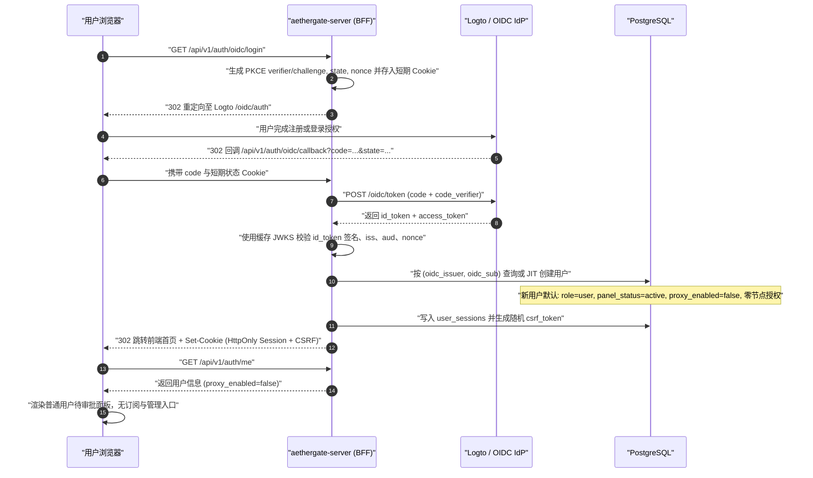
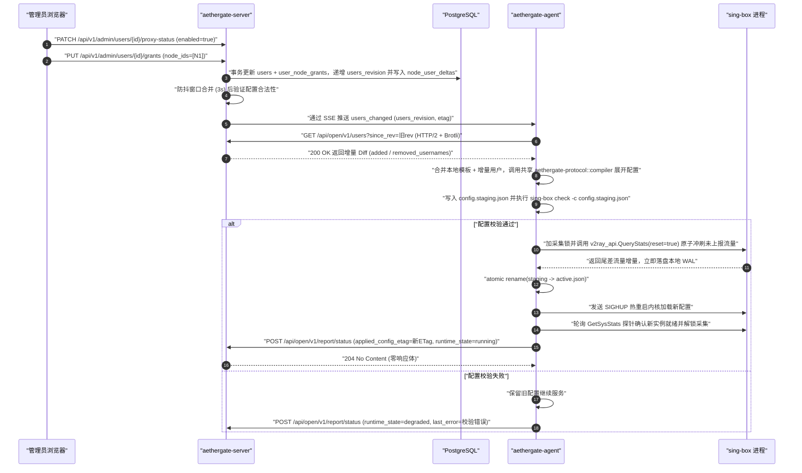
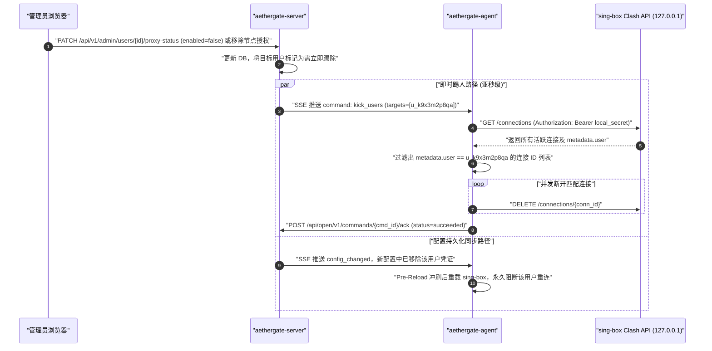
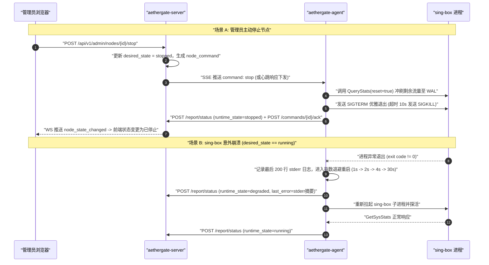
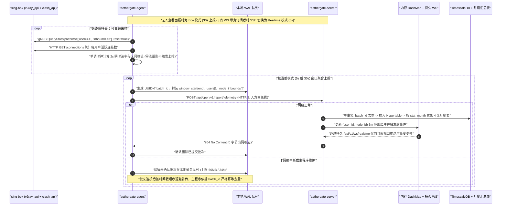

# 01 - 系统总体架构与核心工作流

> 本文档阐述 **Æthergate** 的全局物理与逻辑拓扑、关键架构决策记录（ADR-001 至 ADR-009）以及涵盖 OIDC 注册、四协议配置增量下发、即时断连、节点启停和省流实时三维统计的核心端到端时序图。

---

## 1. 系统总体拓扑

Æthergate 采用经典的**控制面（Control Plane）与数据面（Data Plane）物理分离**架构。控制面部署在中心管理服务器（支持单机或高可用多实例）；数据面分布在全球各节点 VPS 上，由轻量级守护程序 `aethergate-agent` 监管 `sing-box` 核心进程。所有节点仅主动对外发起出向 HTTPS 请求（零入站管理端口暴露）。

```mermaid
flowchart TB
    subgraph Clients["客户端与浏览器层"]
        UserWeb["普通用户浏览器"]
        AdminWeb["管理员浏览器"]
        ProxyClient["代理客户端 (sing-box / Mihomo / Shadowrocket)"]
    end

    subgraph Identity["身份认证层 (外部 OIDC IdP)"]
        Logto["Logto / 标准 OIDC Provider"]
    end

    subgraph ControlPlane["控制面主程序 (aethergate-server - Rust / Axum 0.8 + 内嵌 SPA)"]
        EmbeddedUI["rust-embed 前端静态资产 (frontend/dist)"]
        AuthBFF["OIDC BFF 会话与 RBAC 鉴权"]
        PanelAPI["面板与门户 REST API (/api/v1/*)"]
        SubEndpoint["四协议订阅分发 (/sub/{token})"]
        WSBroker["实时带宽 WebSocket 广播 (/api/v1/ws/realtime)"]
        ConfigCompiler["sing-box 1.12+ 四协议配置编译器"]
        TelemetryEngine["三维流量与瞬时带宽引擎"]
        OpenAPI["类 Hy2 节点开放 API (/api/open/v1/*)"]
        SSEHub["出向 SSE 实时指令中心"]
    end

    subgraph Storage["持久化与时序存储层"]
        PG["PostgreSQL 16/17 + TimescaleDB (业务表 + Hypertable + CAGG)"]
    end

    subgraph NodeVPS["代理节点 VPS (systemd 单文件或独立 Agent 容器)"]
        Agent["aethergate-agent (Rust 守护进程)"]
        LocalWAL["本地 WAL 断网缓冲队列"]
        SingBox["sing-box v1.12+/1.13+ (Hysteria 2 / VLESS-REALITY / TUIC / AnyTLS)"]
    end

    UserWeb -->|"HTTPS Cookie + CSRF / 静态页面"| EmbeddedUI
    AdminWeb -->|"HTTPS Cookie + CSRF / 静态页面"| EmbeddedUI
    UserWeb -->|"HTTPS Cookie + CSRF"| PanelAPI
    AdminWeb -->|"HTTPS Cookie + CSRF"| PanelAPI
    AdminWeb -->|"WSS 实时订阅"| WSBroker
    UserWeb -->|"WSS 个人带宽订阅"| WSBroker
    UserWeb <-->|"OIDC Authorization Code + PKCE"| Logto
    AuthBFF <-->|"Discovery / Token / JWKS"| Logto

    PanelAPI --> AuthBFF
    PanelAPI --> ConfigCompiler
    PanelAPI --> TelemetryEngine
    PanelAPI --> SSEHub
    SubEndpoint --> PG

    ConfigCompiler --> PG
    TelemetryEngine --> PG
    TelemetryEngine -->|"实时 Push"| WSBroker

    Agent -->|"HTTPS 鉴权/拉配置/上报状态与遥测"| OpenAPI
    Agent <-->|"出向 HTTPS SSE 长连接"| SSEHub
    Agent <--> LocalWAL
    Agent -->|"本地 gRPC 127.0.0.1 (v2ray_api)"| SingBox
    Agent -->|"本地 HTTP 127.0.0.1 (clash_api 踢人/连接数)"| SingBox
    Agent -->|"进程启停 / SIGHUP / check 校验"| SingBox

    ProxyClient -->|"TCP: VLESS-REALITY, AnyTLS / UDP: Hy2, TUIC"| SingBox
```

### 拓扑核心特征

1. **控制面零直连节点**：主程序从不主动 SSH 或连接节点 VPS 的任何端口；即使节点位于 NAT 后方或防火墙严格屏蔽入站（仅放行代理业务端口），仍可通过出向 HTTPS 与 SSE 与控制面保持毫秒级同步。
2. **本机环回隔离**：`sing-box` 的 `experimental.v2ray_api` 与 `experimental.clash_api` 严格绑定在 `127.0.0.1` 随机/配置环回端口上，由本机 `aethergate-agent` 消费，绝不暴露于公网。
3. **四协议单核合一**：节点仅运行一个 `sing-box` 进程，同时监听 TCP（`VLESS + REALITY`、`AnyTLS`）与 UDP（`Hysteria 2`、`TUIC v5`）入站，由 `aethergate-agent` 统一守护与采集。

---

## 2. 核心架构决策记录 (ADR)

### ADR-001：节点守护程序采用 Rust 外部守护官方 `sing-box` 二进制，而非 Go 内嵌库

- **背景与调研结论**：
  1. 官方 `sing-box` 二进制实现的 `experimental.v2ray_api` **仅包含 `StatsService`**（流量统计），**并未实现 `HandlerService`**（不支持 `AddUser` / `RemoveUser` 动态热增删用户）。
  2. 向 `sing-box` 发送 `SIGHUP` 会触发核心销毁旧 `Box` 实例并重建新实例（`Box.Close()` -> 重建），不仅会断开该节点当时的活跃代理连接，还会**清空内存中尚未读取的 V2Ray 统计计数器**。
  3. 即便改用 Go 将 `sing-box` 作为库内嵌编译（如 V2bX 模式），`sing-box` 顶层 `inbound.Adapter` 也并未向外暴露协议服务内部的 `UpdateUsers()` 方法，必须镜像复制并修改官方 `protocol/*` 内部代码；面对 `sing-box` 1.11 -> 1.12 -> 1.13 的高频重构（DNS 重构、AnyTLS 引入、Route Actions 迁移），维护魔改分支的升级成本极高。
- **决策**：采用 Rust 编写 `aethergate-agent`，以独立子进程形式守护**未修改的官方 `sing-box` 二进制**（要求包含 `-tags with_v2ray_api`），并通过以下组合机制消除副作用：
  1. **Pre-Reload Atomic Flush（重载前原子冲刷）**：在写入新配置、发送 `SIGHUP` 或停止进程前的毫秒级窗口内，先锁定采集器并调用 `v2ray_api.QueryStats(reset=true)` 强制冲刷出所有未上报流量尾差写入本地 WAL，确保统计**零丢失**。
  2. **防抖合并重载（3s ~ 5s Debounce Window）**：管理员连续为某节点勾选多个用户授权时，服务端通过版本号修订与 Agent 侧防抖合并为一次配置重载，避免连续断流。
  3. **Clash API 即时精确踢人**：当管理员仅需封禁或撤销少数用户权限时，不等待也不必依赖整机断开来阻断流量——Agent 在收到配置变更或 `kick_users` 指令时，立即查询本地 `clash_api` `GET /connections` 按 `metadata.user` 过滤并调用 `DELETE /connections/{id}` 实现亚秒级强制断连。
  4. **抽象 `CoreDriver` Trait**：在 Agent 内部抽象驱动接口（`ExternalBinaryDriver` 为默认实现），未来若官方原生支持细粒度热更新或需接入自定义 Go 驱动，可无痛切换。

### ADR-002：类 Hysteria 2 开放 HTTP/JSON API + 出向 SSE 实时指令通道

- **背景**：Hysteria 2 的外部鉴权（`POST` JSON 返回 `{ "ok": true, "id": "..." }`）与流量统计 API 以简洁、强契约、无重型框架绑定著称。我们需要为节点端设计一套跨语言易对接、支持断网降级、且具备实时控制能力的开放 API。
- **决策**：
  - 定义统一的 REST/JSON 契约 `/api/open/v1/*`：鉴权、拉取配置（支持 `ETag`/`304`）、拉取用户清单、上报节点状态、批量上报遥测。
  - **原生兼容 Hysteria 2 External HTTP Auth**：提供 `POST /api/open/v1/auth/client` 端点（请求兼容 `{addr, auth/payload, tx}`，固定 HTTP 200 返回 `{ok, id}`），除服务本体系节点外，未来亦可直接接入原生独立部署的 Hysteria 2 节点。
  - **双向控制补偿**：在纯拉取（Polling）基础上增加 Agent 主动发起的出向 HTTPS **SSE（Server-Sent Events）**长连接 `GET /api/open/v1/events`，实现启停、配置下发、立即踢人指令的毫秒级触达；当 SSE 意外断开时，自动平滑退化为 5 秒一次的 `POST /report/status` 心跳携带 `pending_commands` 兜底。

### ADR-003：声明式期望状态 (`desired_state`) 与实际运行态 (`runtime_state`) 分离

- **决策**：控制面对节点启停的管理操作修改的是数据库中的 `desired_state`（仅取值 `running` 或 `stopped`）。
  - 当管理员在面板点击「停止节点」时，主程序下发指令使 `aethergate-agent` **优雅停止其守护的 `sing-box` 子进程**（此前执行 Pre-Reload 冲刷流量），释放代理业务端口；但 `aethergate-agent` 本身始终以 `systemd` 服务保持在线与心跳，从而实现「管理员随时在面板一键重新启动节点」而无需登录 VPS 手动拉起。
  - 若 `agent` 失联超过心跳超时阈值（如 `30s`），主程序 Watchdog 将节点 `agent_online` 置为 `false` 并标注 `runtime_state = 'offline'`，同时保留 `desired_state` 不变以便网络恢复后自动对齐期望状态。

### ADR-004：双通道三维流量与瞬时带宽架构（Hot Path + Cold Path）

- **背景**：系统要求同时查看「用户」「节点」「用户+节点」三个维度的**累计使用流量**与**瞬时带宽**，且管理面板支持动态实时图表。直接以秒级高频读写数据库聚合瞬时带宽会击穿数据库 IO。
- **决策**：建立**热冷分离双通道**：
  - **Hot Path（瞬时带宽实时流与持久 WebSocket）**：`aethergate-agent` 本机始终维持每 **2s** 一次 `QueryStats(reset=true)` 高频采样以保留精准 2s 瞬时峰值（`peak_up_bps`/`peak_down_bps`），并根据当前是否有人在线观测面板在 **Realtime 模式（5s 上报）** 与 **Eco 节能模式（30s 合并上报）** 间动态切换；控制面收到遥测后更新内存 `DashMap<(UserId, NodeId), LiveRingBuffer>`（保留最近 5 分钟），由 `WsDeltaDispatcher` **仅在数值发生变化或超时衰减归零时通过持久 WebSocket 连接（`/api/v1/ws/realtime`，启用 `permessage-deflate`）执行事件驱动脏推送**，在确保不断连与毫秒级节点状态触达的同时消除空转重复帧。**引入 Staleness Decay**：若某 `(user, node)` 超过 `3 * active_report_interval` 未收到新样本，瞬时带宽自动衰减归零，避免节点掉线时界面速率卡死。
  - **Cold Path（按自然月分桶与多级时序聚合）**：同一份上报在单事务内完成 `batch_id` 幂等去重、写入 TimescaleDB Hypertable（`traffic_samples_raw` 与 `node_inbound_samples_raw`），并依据批次 `window_end` 在配置统计时区（默认 `Asia/Shanghai`）所属的自然月 `stat_month`（恒为当月 1 号，如 `2026-11-01`），以 `ON CONFLICT (stat_month, ...) DO UPDATE` 原子累加至四张月度汇总表（`user_monthly_traffic`、`node_monthly_traffic`、`user_node_monthly_traffic`、`node_inbound_monthly_traffic`）。**每月 1 号 00:00 自动落入新月份分桶、天然从 0 开始计算，免除定时清零脚本与午夜竞态风险，同时永久保留历史各月统计与跨月 WAL 补传精确归月能力**。历史带宽曲线与任意时段流量由 `1m`/`1h`/`1d` Continuous Aggregates 支撑。

### ADR-005：通用 OIDC BFF 会话模式与默认拒绝代理权限

- **决策**：
  - **认证模式**：采用 **Backend-for-Frontend (BFF)** 模式，由 Rust 后端直接与 Logto / 通用 OIDC IdP 完成 Authorization Code + PKCE 交互，前端仅持有 `HttpOnly; Secure; SameSite=Lax` 的主站会话 Cookie 与可读 CSRF Token。相比纯 SPA 存储 Bearer Token：1）零供应商前端 SDK 锁定（无需绑定 `@logto/react`，更换 Authentik/Keycloak 仅改后端环境变量）；2）XSS 无法窃取长效 Refresh Token；3）管理员在面板封禁某用户可立即吊销其 `user_sessions`，无需等待 JWT 自然过期。
  - **正交三权限模型（Default-Deny）**：每个用户在数据库中强制拆分三个正交字段：
    1. `role` (`'admin' | 'user'`)：控制面板路由与管理 API 权限；
    2. `panel_status` (`'active' | 'banned'`)：控制能否登录面板；
    3. `proxy_enabled` (`boolean`, **默认 `false`**)：控制能否生成节点配置、拉取订阅和使用代理。
  - 自助注册的新用户恒为 `role='user', panel_status='active', proxy_enabled=false` 且没有任何节点授权，登录后仅可进入普通用户面板查看自己的状态并等待管理员审批开启。

### ADR-006：不可变 `proxy_username` 与全局唯一 `proxy_password`

- **决策**：
  - 用户 JIT 注册时生成不可变短标识 `proxy_username`（格式 `u_<10位小写字母数字>`，例如 `u_k9x3m2p8qa`），贯穿注入 `sing-box` 全部四协议入站 `users[].name` 与 `v2ray_api.stats.users`。用户日后修改 OIDC 显示名或邮箱绝不会割裂历史流量统计。
  - 用户同时拥有随机生成且全库唯一的 `proxy_uuid`（用于 VLESS / TUIC）和全局唯一的 `proxy_password`（24 字节 URL-safe 随机串，用于 Hysteria 2 / TUIC / AnyTLS），从根源避免密码碰撞导致的跨用户流量串账。

### ADR-007：单节点四协议共存与节点级共享 TLS 证书模型

- **决策**：
  - 每个节点拥有独立子表 `node_inbounds`，首期限定支持 `hysteria2`、`vless_reality`、`tuic`、`anytls` 四类入站并可各自独立启用/停用。
  - 针对需要 TLS 证书的三个协议（`hysteria2`、`tuic`、`anytls`），不在各个协议入站里重复配置易冲突的 ACME，而在**节点层统一维护 `tls_profile`**：
    - `external_files`（生产推荐）：统一挂载由主机 Caddy/Certbot/`acme.sh` 签发的 PEM 文件路径，三协议共享引用。
    - `self_signed`（无域名开箱即用）：Agent 自动生成 ECDSA P-256 证书并向主程序回传 `tls_cert_sha256`（`pinSHA256`），订阅链接自动附带指纹参数实现安全免域名连接。
    - `singbox_acme`（可选单域名内置 ACME）：当节点仅启用单一内置 ACME 或共享 TLS 块时受控使用。

### ADR-008：单文件静态交付 (`rust-embed`) 与双 `scratch` 多架构容器化策略

- **背景**：项目需同时满足裸机单文件开箱部署与标准化云原生 Docker 容器交付，且主机控制面与远端节点端生命周期完全解耦（不可强耦合为同一镜像）。
- **决策**（参考 `Linguist-New` 工程交付范式）：
  1. **控制面真单文件交付**：前端打包产物（`frontend/dist`）与 SQLx 迁移脚本（`migrations/`）通过 `rust-embed` 与 `sqlx::migrate!()` 编译内嵌至 `aethergate-server` 单个二进制文件中，无需额外部署 Nginx 托管静态资源。结合纯 Rust TLS 栈（`rustls` + `webpki-roots` + `native-roots`）实现全平台静态链接（Linux x64/arm64 `musl +crt-static`、Windows x64/arm64）。
  2. **主机与节点各自独立的极简 `FROM scratch` 容器**：
     - **主机镜像 (`ghcr.io/<owner>/aethergate-server`)**：仅含静态编译的 `/aethergate-server` 与非 root 只读配置目录 `/config`（`USER 65532:65532`），无 shell/包管理器攻击面，默认以 `read_only: true` + `cap_drop: [ALL]` 运行。
     - **节点镜像 (`ghcr.io/<owner>/aethergate-agent`)**：仅含静态 `aethergate-agent`、内置 CA 根证书及静态 `sing-box`（v1.12+ 含 `with_v2ray_api`），非 root 运行并通过 `network_mode: host` 与最小能力 `CAP_NET_BIND_SERVICE` 零损耗转发四协议 TCP/UDP/QUIC 流量。
  3. **多架构先测后推流水线**：`linux/amd64` 与 `linux/arm64` 均在原生 GitHub Runner 上编译并通过容器自动化校验脚本后，才按 digest 推送 GHCR 并拼装 multi-arch manifest。

### ADR-009：面向按量计费云主机（阿里云 ECS 仅出方向计费）的控制面极省出网优化架构

- **背景**：若主服务器部署于阿里云按使用流量计费的 ECS（仅公网出方向计费，公网入方向与同地域 VPC 内网均免费），控制面应尽最大可能压缩向公网响应的数据字节数，同时严禁以牺牲流量/带宽统计准确性或破坏面板持久 WebSocket 实时体验为代价。
- **决策**：建立五维出网省流架构：
  1. **配置下沉 Agent 本地展开 + 增量用户同步**：将 `sing-box` 1.12+ 编译器移入共享库 `aethergate-protocol`。控制面 `GET /config` 仅下发 ~1 KB 的无用户节点模板（常年 `304`）；`GET /users?since_rev=` 仅下发去重单份凭证或 `added/removed` 增量 Diff 并启用 Brotli/Gzip 压缩，消除了 4 协议 + `v2ray_api` 造成的 5 倍出网冗余。
  2. **HTTP/2 长连接 + 常态 `204 No Content` + Eco/Realtime 自适应上报**：开放 API 走 HTTP/2 HPACK 头部压缩；遥测与心跳无指令/踢人时返回 **0 字节 `204`**；无人浏览面板时自动通过 SSE 切为 30s Eco 合并上报（零流量窗口静默跳过），有人看面板切回 5s Realtime；SSE 保活拉长至 `50s` 极简 3 字节 `:\n\n`。
  3. **保留持久面板 WebSocket + 事件驱动脏推送 + 视口订阅**：保持 `/api/v1/ws/realtime` 不断连与 `permessage-deflate` 压缩，不发未变化重复帧或全量 0 值；切后台 30s 仅暂停重型带宽频道而不断开 WS 与节点状态频道。
  4. **前端 Brotli 预压缩 + SPA 白名单路由防扫描器**：内嵌 `.br` (level 11) 资产并使用系统字体栈；未知探测路径（如 `.php`/`.env`）直接返回 **0 字节 `404`**，严防公网扫描器刷出高额 `index.html` 出网流量。
  5. **基础设施零出网分流**：所有安装包与容器镜像由 GitHub Releases / GHCR 直接分发；PostgreSQL/TimescaleDB 走同机或 VPC 内网；阿里云控制台配置 `5~10 Mbps` 出带宽上限与费用预警兜底。

---

## 3. 五大核心端到端工作流时序

### 3.1 用户 OIDC 自助注册与 JIT 建档

### 3.2 管理员启用用户与授权节点 -> 增量同步、本地编译与节点重载

### 3.3 管理员禁用用户或撤销某节点权限 -> Clash API 即时踢断连接

### 3.4 管理员启停节点与异常崩溃自愈

### 3.5 三维统计采集、自适应省流上报与持久 WS 脏推送

