# 02 - 主程序后端架构、数据库与四协议配置编译引擎

> 本文档详细定义控制面主程序 `aethergate-server` 的 Rust 分层模块化架构、PostgreSQL 16/17 + TimescaleDB 完整数据库与时序存储建模、OIDC/Logto BFF 鉴权实现、三维流量与瞬时带宽引擎，以及针对 `sing-box` v1.12+/v1.13+ 的四协议（`Hysteria 2`、`VLESS + REALITY`、`TUIC v5`、`AnyTLS`）配置编译器设计。

---

## 1. 主程序后端架构 (`aethergate-server`)

### 1.1 运行时状态与依赖注入模型

`aethergate-server` 基于 **Tokio** 异步运行时与 **Axum 0.8** Web 框架构建。全局共享上下文 `AppState` 通过 `Arc` 在 HTTP 路由、SSE 长连接处理器、WebSocket 广播器及后台任务间零拷贝共享：

```rust
pub struct AppState {
    pub cfg: Arc<ServerConfig>,
    pub db: sqlx::PgPool,
    pub master_key: Arc<Aes256GcmKey>,             // 静态加密敏感凭证与节点私钥
    pub oidc: Arc<OidcClientManager>,               // Discovery + JWKS 缓存 + PKCE 交互
    pub live_metrics: Arc<LiveMetricsStore>,        // DashMap 5 分钟三维瞬时带宽热路径
    pub node_events: Arc<NodeEventHub>,             // 按 node_id 索引的 SSE 广播通道
    pub realtime_ws: Arc<RealtimeBroadcastHub>,     // 面向前端 WS 的 1s 实时帧分发器
    pub compile_debouncer: Arc<CompileDebouncer>,   // 3s 防抖合并配置编译与下发
}
```

### 1.2 Axum 0.8 路由挂载规范

> **重要工程约束**：Axum 0.8 将底层路由引擎升级至 `matchit 0.8`，路径参数语法已从 `/:id` 变更为 **`/{id}`**，通配符语法变更为 **`/{*rest}`**。若使用旧版 `/:id` 语法，服务端将在启动注册路由时直接 **panic**。

```text
Router::new()
  ├── /healthz, /readyz, /metrics                    # 探针与 Prometheus 指标
  ├── /sub/{token}                                   # 多格式用户订阅分发 (无 Cookie, 强限流)
  ├── /api/open/v1                                   # 类 Hy2 节点开放 API (NodeAuth 中间件)
  │     ├── POST   /auth/verify
  │     ├── POST   /auth/client                      # 原生兼容 Hysteria 2 External HTTP Auth
  │     ├── GET    /config
  │     ├── GET    /users
  │     ├── POST   /report/status
  │     ├── POST   /report/telemetry
  │     ├── GET    /events                           # 出向 SSE 实时指令流
  │     └── POST   /commands/{command_id}/ack
  └── /api/v1                                        # 面板与门户 API
        ├── /auth/*                                  # OIDC Login / Callback / Logout / Me
        ├── /ws/realtime                             # WebSocket 实时带宽与节点状态推流
        ├── /my/*                                    # 普通用户自助门户 (RequireActivePanel)
        └── /admin/*                                 # 管理员路由 (RequireAdmin + CSRF)
              ├── /nodes/{id}/*                      # 节点 CRUD, 启停重载, 安装脚本
              ├── /nodes/{id}/inbounds/{inbound_id}  # 四协议入站管理
              ├── /node-groups/{id}/*
              ├── /users/{id}/*                      # 启停代理, 封禁, 授权, 踢线
              ├── /stats/*                           # 三维流量, 瞬时带宽, 交叉矩阵, 协议分布
              ├── /tools/generate-keys               # X25519 REALITY 密钥对/UUID 生成器
              └── /audit-logs, /settings
```

### 1.3 后台守护协程 (`workers/`)

| 后台任务 | 触发周期 | 核心职责 |
| :--- | :--- | :--- |
| `NodeHealthWatchdog` | 每 10s 扫描 | 检测 `last_heartbeat_at < now() - 180s`（SSE 断连或无心跳）的节点，置 `agent_online = false`、`runtime_state = 'offline'` 并通过持久 WS 推送节点离线事件 |
| `LiveStalenessReaper` | 每 5s 执行 | 扫描内存 `LiveMetricsStore`，对超过 `3 * active_report_interval` 未收到上报的 `(user_id, node_id)` 槽位执行衰减归零并触发一次脏推送 |
| `WsDeltaDispatcher` | 事件驱动（最大 1s 合批） | 监听遥测更新、衰减归零与节点状态事件，通过持久 `/api/v1/ws/realtime` 仅推送实际发生变化的频道数据（无变更不发重复帧、零值只推一次归零） |
| `TelemetryCadenceController` | 状态变更 + 60s 防抖 | 统计当前挂载重型带宽频道的活跃 WS 订阅者数；从 `0 -> >=1` 时立即通过 SSE 切为 `realtime` (5s)；归零保持 60s 后通知在线节点切为 `eco` (30s) |
| `CompileDebouncer` | 事件驱动 + 3s 窗口 | 合并短时间内多次授权/用户开关变更，递增 `users_revision`、生成增量记录并下发 `users_changed` / `config_changed` SSE |
| `HousekeepingWorker` | 每 1h / 每日 | 清理过期 `user_sessions`、`telemetry_batch_dedup`（72h）、各节点 100 条之前的 `node_user_deltas` 及超时未确认 `node_commands` |

### 1.4 单文件内嵌前端、省流静态托管与 CLI 入口

参考 `Linguist-New` 的单文件静态分发模型，并针对阿里云 ECS 公网出方向计费深度优化静态资源回包：

1. **`rust-embed` 预压缩静态托管 (`web_assets.rs`)**：
   - 前端构建期生成 **Brotli (level 11, `.br`)** 与 Gzip (`.gz`) 预压缩产物并通过 `#[derive(RustEmbed)] #[folder = "../../frontend/dist"]` 编译内嵌；服务端依据请求头 `Accept-Encoding` 零 CPU 开销直接返回预压缩字节流；
   - 面板采用系统无衬线/等宽字体栈，不内嵌大型 WebFont；`/assets/*` 强制返回 `Cache-Control: public, max-age=31536000, immutable`（二次访问 0 字节）；
   - **SPA 路由白名单防扫描器**：仅当请求路径精确匹配合法前端路由前缀（`/`、`/sign-in`、`/portal`、`/portal/*`、`/admin`、`/admin/*`）时回落返回 `index.html`；对扫描器高频探测的未知路径（如 `.php`、`.env`、`/wp-*`、随机路径）及未知 `/api/*`、`/sub/*` **一律直接返回 0 字节 `404 Not Found`**，彻底杜绝恶意扫描器刷高出网流量。
2. **`clap` 标准化 CLI 子命令**：
   - `aethergate-server serve --config /config/config.toml`：执行内嵌 `sqlx::migrate!()`（可通过 `--skip-migrate` 关闭）并启动 HTTP/WS/SSE 服务与后台 Workers；
   - `aethergate-server check-config --config /config/config.toml`：不启动网络监听，离线/连通校验 TOML 格式、主加密密钥长度、PostgreSQL TLS 连通性及 OIDC Discovery 可达性（供容器启动前与 CI 容器验收脚本调用）；
   - `aethergate-server migrate --config /config/config.toml`：仅执行数据库迁移后退出（适用于多副本滚动升级前的独立 Job）。
3. **只读容器友好的配置与密钥分离加载 (`config.rs`)**：
   - 支持 `config.toml`（挂载于只读 `/config/config.toml`）+ 环境变量覆盖（`AETHERGATE_*`）+ 独立文件引用密钥（如 `oidc.client_secret_file = "/config/secrets/oidc-client-secret"`、`database.url_file`）；
   - 配置 `[stats] timezone = "Asia/Shanghai"`（标准 IANA 时区名）专门控制**每月 1 号 `00:00:00` 自然月分账切换边界**与报表自然日对齐；
   - 通过同时启用 `reqwest` 的 `rustls-tls-webpki-roots` 与 `rustls-tls-native-roots`，保证在极简 `FROM scratch` 容器内既无需手动挂载 CA 即可访问公网 OIDC/Logto，也能通过环境变量 `SSL_CERT_FILE=/config/certs/ca.crt` 信任内网私有 CA。

### 1.5 Workspace 严格 Lint 与 Release 编译优化规范

为确保控制面、守护程序与共享协议库的代码质量与生产极简体积，根 `Cargo.toml` 强制开启与 `Linguist-New` 同等级的 Workspace 级静态检查与 LTO 优化配置：

```toml
[workspace.lints.rust]
unsafe_code = "forbid"
missing_docs = "deny"
missing_debug_implementations = "deny"
unused = { level = "deny", priority = -1 }
rust_2024_compatibility = { level = "deny", priority = -1 }

[workspace.lints.clippy]
all = { level = "deny", priority = -1 }
pedantic = { level = "deny", priority = -1 }
cargo = { level = "deny", priority = -1 }
unwrap_used = "deny"
expect_used = "deny"
panic = "deny"
todo = "deny"
unimplemented = "deny"
missing_docs_in_private_items = "deny"
multiple_crate_versions = "allow"

[profile.release]
opt-level = 3
lto = "fat"
codegen-units = 1
panic = "abort"
strip = true
incremental = false
```

---

## 2. 数据库与时序存储建模 (PostgreSQL 16/17 + TimescaleDB)

### 2.1 核心实体关系图 (ER Diagram)

```mermaid
erDiagram
    users ||--o{ user_sessions : "has"
    users ||--o{ user_node_grants : "direct_access"
    users ||--o{ user_node_group_grants : "group_access"
    users ||--o{ user_monthly_traffic : "monthly_agg"
    users ||--o{ user_node_monthly_traffic : "per_node_monthly"

    nodes ||--o{ node_inbounds : "exposes_4_protocols"
    nodes ||--o{ node_group_members : "belongs_to"
    nodes ||--o{ user_node_grants : "granted_to"
    nodes ||--o{ node_commands : "executes"
    nodes ||--o{ node_monthly_traffic : "monthly_agg"
    nodes ||--o{ user_node_monthly_traffic : "per_user_monthly"
    nodes ||--o{ node_inbound_monthly_traffic : "protocol_monthly"

    node_groups ||--o{ node_group_members : "contains"
    node_groups ||--o{ user_node_group_grants : "granted_to"

    users ||--o{ traffic_samples_raw : "generates"
    nodes ||--o{ traffic_samples_raw : "collects"
    nodes ||--o{ node_inbound_samples_raw : "protocol_stats"
```



### 2.2 完整 SQL DDL（关系核心表）

```sql
-- 启用必要扩展
CREATE EXTENSION IF NOT EXISTS pgcrypto;
CREATE EXTENSION IF NOT EXISTS timescaledb;

-- ============================================================
-- 1. 用户与认证域 (默认拒绝代理权限，仅可访问面板)
-- ============================================================
CREATE TABLE users (
    id                      UUID PRIMARY KEY DEFAULT gen_random_uuid(),
    oidc_issuer             TEXT NOT NULL,
    oidc_sub                TEXT NOT NULL,
    email                   TEXT NOT NULL,
    display_name            TEXT NOT NULL,
    avatar_url              TEXT,

    -- 三正交权限字段
    role                    TEXT NOT NULL DEFAULT 'user'
                            CHECK (role IN ('admin', 'user')),
    panel_status            TEXT NOT NULL DEFAULT 'active'
                            CHECK (panel_status IN ('active', 'banned')),
    proxy_enabled           BOOLEAN NOT NULL DEFAULT FALSE,

    -- 不可变代理标识与协议凭证 (全库唯一防串账)
    proxy_username          TEXT NOT NULL UNIQUE,   -- e.g. 'u_k9x3m2p8qa'
    proxy_uuid              UUID NOT NULL UNIQUE,   -- 用于 VLESS + TUIC
    proxy_password_enc      BYTEA NOT NULL,         -- AES-256-GCM 密文 (用于 Hy2/TUIC/AnyTLS)
    proxy_password_hash     BYTEA NOT NULL UNIQUE,  -- SHA-256(proxy_password) 保证全局唯一
    subscription_token_hash BYTEA NOT NULL UNIQUE,  -- SHA-256(sub_token)

    -- 生命周期与备注
    expires_at              TIMESTAMPTZ,
    remark                  TEXT,

    last_login_at           TIMESTAMPTZ,
    created_at              TIMESTAMPTZ NOT NULL DEFAULT now(),
    updated_at              TIMESTAMPTZ NOT NULL DEFAULT now(),

    CONSTRAINT uq_users_oidc_identity UNIQUE (oidc_issuer, oidc_sub)
);

CREATE INDEX idx_users_pending_approval ON users (created_at DESC)
    WHERE panel_status = 'active' AND proxy_enabled = FALSE;
CREATE INDEX idx_users_email ON users (lower(email));

-- ------------------------------------------------------------
-- BFF 会话表
-- ------------------------------------------------------------
CREATE TABLE user_sessions (
    session_id_hash         BYTEA PRIMARY KEY,      -- SHA-256(session_cookie)
    user_id                 UUID NOT NULL REFERENCES users(id) ON DELETE CASCADE,
    oidc_id_token_hint_enc  BYTEA,                  -- 用于 RP-Initiated Logout
    csrf_token              TEXT NOT NULL,
    ip_addr                 INET,
    user_agent              TEXT,
    expires_at              TIMESTAMPTZ NOT NULL,
    revoked_at              TIMESTAMPTZ,
    created_at              TIMESTAMPTZ NOT NULL DEFAULT now()
);

CREATE INDEX idx_user_sessions_user_active ON user_sessions (user_id, expires_at)
    WHERE revoked_at IS NULL;

-- ============================================================
-- 2. 节点、四协议入站与分组授权域
-- ============================================================
CREATE TABLE nodes (
    id                      UUID PRIMARY KEY DEFAULT gen_random_uuid(),
    name                    TEXT NOT NULL,
    slug                    TEXT NOT NULL UNIQUE,
    region                  TEXT NOT NULL DEFAULT 'default',
    host                    TEXT NOT NULL,          -- 客户端连接地址 (域名或公网 IP)
    tags                    TEXT[] NOT NULL DEFAULT '{}',

    -- 类 Hy2 开放 API 鉴权凭证
    api_token_hash          BYTEA NOT NULL UNIQUE,  -- SHA-256(node_api_token)
    hmac_secret_enc         BYTEA NOT NULL,         -- AES-256-GCM 加密 HMAC 签名密钥

    -- 期望状态 vs 运行态分离
    desired_state           TEXT NOT NULL DEFAULT 'running'
                            CHECK (desired_state IN ('running', 'stopped')),
    runtime_state           TEXT NOT NULL DEFAULT 'offline'
                            CHECK (runtime_state IN (
                                'offline', 'stopped', 'starting',
                                'running', 'reloading', 'stopping',
                                'degraded', 'error'
                            )),
    agent_online            BOOLEAN NOT NULL DEFAULT FALSE,
    agent_version           TEXT,
    singbox_version         TEXT,

    -- 配置版本与 ETag 校验
    config_revision         BIGINT NOT NULL DEFAULT 1,
    compiled_config_etag    TEXT,
    applied_config_etag     TEXT,
    users_revision          BIGINT NOT NULL DEFAULT 1,
    compiled_users_etag     TEXT,
    applied_users_etag      TEXT,

    -- 节点级共享 TLS 证书策略与共享路由/DNS模板
    tls_profile_json        JSONB NOT NULL DEFAULT '{"mode":"self_signed","server_name":"","cert_path":"/etc/aethergate/certs/fullchain.pem","key_path":"/etc/aethergate/certs/privkey.pem"}'::jsonb,
    tls_cert_sha256         TEXT,                   -- Agent 上报的当前证书 pinSHA256
    dns_route_json          JSONB NOT NULL DEFAULT '{}'::jsonb,
    report_interval_sec     INTEGER NOT NULL DEFAULT 5 CHECK (report_interval_sec BETWEEN 2 AND 60),

    -- 运行遥测摘要
    last_heartbeat_at       TIMESTAMPTZ,
    last_error              TEXT,
    cpu_usage_pct           REAL,
    mem_used_bytes          BIGINT,
    mem_total_bytes         BIGINT,
    uptime_sec              BIGINT,
    active_connections      INTEGER NOT NULL DEFAULT 0,

    created_at              TIMESTAMPTZ NOT NULL DEFAULT now(),
    updated_at              TIMESTAMPTZ NOT NULL DEFAULT now()
);

CREATE INDEX idx_nodes_online_heartbeat ON nodes (agent_online, last_heartbeat_at);

-- ------------------------------------------------------------
-- 节点四协议入站配置表 (单节点支持多入站并存)
-- ------------------------------------------------------------
CREATE TABLE node_inbounds (
    id                      UUID PRIMARY KEY DEFAULT gen_random_uuid(),
    node_id                 UUID NOT NULL REFERENCES nodes(id) ON DELETE CASCADE,
    protocol                TEXT NOT NULL
                            CHECK (protocol IN ('hysteria2', 'vless_reality', 'tuic', 'anytls')),
    tag                     TEXT NOT NULL,          -- e.g. 'hy2-in', 'vless-reality-in'
    enabled                 BOOLEAN NOT NULL DEFAULT TRUE,
    listen                  TEXT NOT NULL DEFAULT '::',
    listen_port             INTEGER NOT NULL CHECK (listen_port BETWEEN 1 AND 65535),
    transport_layer         TEXT NOT NULL CHECK (transport_layer IN ('tcp', 'udp')),
    port_hopping_range      TEXT,                   -- 可选 Hy2 端口跳跃 e.g. '20000-30000'
    protocol_config         JSONB NOT NULL,         -- 各协议专有参数 (见 §5 编译器规格)
    client_override         JSONB NOT NULL DEFAULT '{}'::jsonb, -- 订阅导出覆写 (如 CDN/中转 host/port)
    sort_order              SMALLINT NOT NULL DEFAULT 0,
    created_at              TIMESTAMPTZ NOT NULL DEFAULT now(),
    updated_at              TIMESTAMPTZ NOT NULL DEFAULT now(),

    CONSTRAINT uq_node_inbounds_tag UNIQUE (node_id, tag)
);

-- 同节点内同一传输层 (TCP 或 UDP) 上已启用的入站端口不可冲突
-- 注: Hysteria 2 的 port_hopping_range 区间重叠由应用层校验器保障
CREATE UNIQUE INDEX uq_node_inbounds_active_port
    ON node_inbounds (node_id, transport_layer, listen_port)
    WHERE enabled = TRUE;

-- ------------------------------------------------------------
-- 节点分组与授权关系
-- ------------------------------------------------------------
CREATE TABLE node_groups (
    id                      UUID PRIMARY KEY DEFAULT gen_random_uuid(),
    name                    TEXT NOT NULL UNIQUE,
    description             TEXT,
    created_at              TIMESTAMPTZ NOT NULL DEFAULT now()
);

CREATE TABLE node_group_members (
    group_id                UUID NOT NULL REFERENCES node_groups(id) ON DELETE CASCADE,
    node_id                 UUID NOT NULL REFERENCES nodes(id) ON DELETE CASCADE,
    PRIMARY KEY (group_id, node_id)
);

CREATE TABLE user_node_grants (
    user_id                 UUID NOT NULL REFERENCES users(id) ON DELETE CASCADE,
    node_id                 UUID NOT NULL REFERENCES nodes(id) ON DELETE CASCADE,
    granted_by              UUID REFERENCES users(id) ON DELETE SET NULL,
    created_at              TIMESTAMPTZ NOT NULL DEFAULT now(),
    PRIMARY KEY (user_id, node_id)
);

CREATE INDEX idx_user_node_grants_node ON user_node_grants (node_id, user_id);

CREATE TABLE user_node_group_grants (
    user_id                 UUID NOT NULL REFERENCES users(id) ON DELETE CASCADE,
    group_id                UUID NOT NULL REFERENCES node_groups(id) ON DELETE CASCADE,
    granted_by              UUID REFERENCES users(id) ON DELETE SET NULL,
    created_at              TIMESTAMPTZ NOT NULL DEFAULT now(),
    PRIMARY KEY (user_id, group_id)
);

-- ------------------------------------------------------------
-- 节点用户增量同步日志 (支撑 GET /api/open/v1/users?since_rev= 省流下发)
-- ------------------------------------------------------------
CREATE TABLE node_user_deltas (
    node_id                 UUID NOT NULL REFERENCES nodes(id) ON DELETE CASCADE,
    revision                BIGINT NOT NULL,
    added_users_json        JSONB NOT NULL DEFAULT '[]'::jsonb, -- [{user_id, proxy_username, proxy_uuid, proxy_password_enc}]
    removed_usernames       TEXT[] NOT NULL DEFAULT '{}',
    created_at              TIMESTAMPTZ NOT NULL DEFAULT now(),
    PRIMARY KEY (node_id, revision)
);

-- ------------------------------------------------------------
-- 节点控制指令队列与审计日志
-- ------------------------------------------------------------
CREATE TABLE node_commands (
    id                      UUID PRIMARY KEY,       -- 应用层生成 UUIDv7
    node_id                 UUID NOT NULL REFERENCES nodes(id) ON DELETE CASCADE,
    command_type            TEXT NOT NULL
                            CHECK (command_type IN ('start', 'stop', 'restart', 'reload', 'kick_users', 'fetch_logs')),
    payload                 JSONB NOT NULL DEFAULT '{}'::jsonb,
    status                  TEXT NOT NULL DEFAULT 'pending'
                            CHECK (status IN ('pending', 'dispatched', 'succeeded', 'failed', 'expired')),
    issued_by               UUID REFERENCES users(id) ON DELETE SET NULL,
    issued_at               TIMESTAMPTZ NOT NULL DEFAULT now(),
    acked_at                TIMESTAMPTZ,
    result_message          TEXT
);

CREATE INDEX idx_node_commands_pending ON node_commands (node_id, issued_at)
    WHERE status IN ('pending', 'dispatched');

CREATE TABLE audit_logs (
    id                      BIGSERIAL PRIMARY KEY,
    actor_user_id           UUID REFERENCES users(id) ON DELETE SET NULL,
    action                  TEXT NOT NULL,          -- e.g. 'user.proxy.enable', 'node.stop', 'inbound.update'
    target_type             TEXT NOT NULL,          -- 'user' | 'node' | 'inbound' | 'group' | 'setting'
    target_id               TEXT NOT NULL,
    diff_json               JSONB NOT NULL DEFAULT '{}'::jsonb,
    ip_addr                 INET,
    created_at              TIMESTAMPTZ NOT NULL DEFAULT now()
);

CREATE INDEX idx_audit_logs_created ON audit_logs (created_at DESC);
CREATE INDEX idx_audit_logs_target ON audit_logs (target_type, target_id, created_at DESC);
```

### 2.3 完整 SQL DDL（幂等去重、三维原子汇总表与 TimescaleDB 时序建模）

```sql
-- ============================================================
-- 3. 遥测幂等去重与按自然月分桶的四张 O(1) 原子汇总表 (每月 1 号从 0 起算)
-- ============================================================
-- 约定: stat_month 恒为统计时区当月 1 号 (如 '2026-11-01')，无需 1 号定时清零任务，
-- 跨月新上报自动落入新月份行，旧月份历史数据永久保留可随时回溯。

CREATE TABLE telemetry_batch_dedup (
    batch_id                UUID PRIMARY KEY,
    node_id                 UUID NOT NULL REFERENCES nodes(id) ON DELETE CASCADE,
    received_at             TIMESTAMPTZ NOT NULL DEFAULT now()
);

CREATE INDEX idx_batch_dedup_received ON telemetry_batch_dedup (received_at);

-- 维度 A: 用户按自然月累计流量
CREATE TABLE user_monthly_traffic (
    stat_month              DATE NOT NULL CHECK (EXTRACT(DAY FROM stat_month) = 1),
    user_id                 UUID NOT NULL REFERENCES users(id) ON DELETE CASCADE,
    up_bytes                BIGINT NOT NULL DEFAULT 0,
    down_bytes              BIGINT NOT NULL DEFAULT 0,
    last_active_at          TIMESTAMPTZ,
    updated_at              TIMESTAMPTZ NOT NULL DEFAULT now(),
    PRIMARY KEY (stat_month, user_id)
);

CREATE INDEX idx_user_monthly_rank ON user_monthly_traffic (stat_month, (up_bytes + down_bytes) DESC);

-- 维度 B: 节点按自然月累计流量
CREATE TABLE node_monthly_traffic (
    stat_month              DATE NOT NULL CHECK (EXTRACT(DAY FROM stat_month) = 1),
    node_id                 UUID NOT NULL REFERENCES nodes(id) ON DELETE CASCADE,
    up_bytes                BIGINT NOT NULL DEFAULT 0,
    down_bytes              BIGINT NOT NULL DEFAULT 0,
    last_active_at          TIMESTAMPTZ,
    updated_at              TIMESTAMPTZ NOT NULL DEFAULT now(),
    PRIMARY KEY (stat_month, node_id)
);

-- 维度 C: 用户 + 节点按自然月交叉累计流量
CREATE TABLE user_node_monthly_traffic (
    stat_month              DATE NOT NULL CHECK (EXTRACT(DAY FROM stat_month) = 1),
    user_id                 UUID NOT NULL REFERENCES users(id) ON DELETE CASCADE,
    node_id                 UUID NOT NULL REFERENCES nodes(id) ON DELETE CASCADE,
    up_bytes                BIGINT NOT NULL DEFAULT 0,
    down_bytes              BIGINT NOT NULL DEFAULT 0,
    last_active_at          TIMESTAMPTZ,
    updated_at              TIMESTAMPTZ NOT NULL DEFAULT now(),
    PRIMARY KEY (stat_month, user_id, node_id)
);

CREATE INDEX idx_user_node_monthly_node ON user_node_monthly_traffic (stat_month, node_id);

-- 维度 D: 节点四协议入站按自然月累计流量 (支持月度协议占比分析)
CREATE TABLE node_inbound_monthly_traffic (
    stat_month              DATE NOT NULL CHECK (EXTRACT(DAY FROM stat_month) = 1),
    node_id                 UUID NOT NULL REFERENCES nodes(id) ON DELETE CASCADE,
    inbound_tag             TEXT NOT NULL,
    protocol                TEXT NOT NULL,
    up_bytes                BIGINT NOT NULL DEFAULT 0,
    down_bytes              BIGINT NOT NULL DEFAULT 0,
    updated_at              TIMESTAMPTZ NOT NULL DEFAULT now(),
    PRIMARY KEY (stat_month, node_id, inbound_tag)
);

-- ============================================================
-- 4. TimescaleDB 时序明细表与 Continuous Aggregates (多级降采样)
-- ============================================================

-- 三维 (User + Node) 原始样本表 (通常为 5s 窗口)
CREATE TABLE traffic_samples_raw (
    bucket_ts               TIMESTAMPTZ NOT NULL,
    node_id                 UUID NOT NULL,
    user_id                 UUID NOT NULL,
    up_bytes                BIGINT NOT NULL CHECK (up_bytes >= 0),
    down_bytes              BIGINT NOT NULL CHECK (down_bytes >= 0),
    duration_ms             INTEGER NOT NULL CHECK (duration_ms > 0),
    avg_up_bps              BIGINT NOT NULL CHECK (avg_up_bps >= 0),
    avg_down_bps            BIGINT NOT NULL CHECK (avg_down_bps >= 0),
    peak_up_bps             BIGINT NOT NULL CHECK (peak_up_bps >= 0),
    peak_down_bps           BIGINT NOT NULL CHECK (peak_down_bps >= 0),
    active_conns            INTEGER NOT NULL DEFAULT 0
);

SELECT create_hypertable('traffic_samples_raw', 'bucket_ts', chunk_time_interval => INTERVAL '1 day');
CREATE INDEX idx_traffic_raw_user_node_ts ON traffic_samples_raw (user_id, node_id, bucket_ts DESC);
CREATE INDEX idx_traffic_raw_node_ts ON traffic_samples_raw (node_id, bucket_ts DESC);

-- 按节点四协议入站记录的原始流量 (支持节点按协议占比统计)
CREATE TABLE node_inbound_samples_raw (
    bucket_ts               TIMESTAMPTZ NOT NULL,
    node_id                 UUID NOT NULL,
    inbound_tag             TEXT NOT NULL,
    protocol                TEXT NOT NULL,
    up_bytes                BIGINT NOT NULL CHECK (up_bytes >= 0),
    down_bytes              BIGINT NOT NULL CHECK (down_bytes >= 0),
    avg_up_bps              BIGINT NOT NULL CHECK (avg_up_bps >= 0),
    avg_down_bps            BIGINT NOT NULL CHECK (avg_down_bps >= 0)
);

SELECT create_hypertable('node_inbound_samples_raw', 'bucket_ts', chunk_time_interval => INTERVAL '1 day');
CREATE INDEX idx_inbound_raw_node_tag_ts ON node_inbound_samples_raw (node_id, inbound_tag, bucket_ts DESC);

-- ------------------------------------------------------------
-- Continuous Aggregates: 1 分钟 / 1 小时 / 1 天自动降采样
-- ------------------------------------------------------------
CREATE MATERIALIZED VIEW traffic_rollup_1m
WITH (timescaledb.continuous) AS
SELECT
    time_bucket('1 minute', bucket_ts) AS bucket,
    node_id,
    user_id,
    SUM(up_bytes)::BIGINT              AS up_bytes,
    SUM(down_bytes)::BIGINT            AS down_bytes,
    AVG(avg_up_bps)::BIGINT            AS avg_up_bps,
    AVG(avg_down_bps)::BIGINT          AS avg_down_bps,
    MAX(peak_up_bps)::BIGINT           AS peak_up_bps,
    MAX(peak_down_bps)::BIGINT         AS peak_down_bps,
    MAX(active_conns)::INTEGER         AS max_active_conns
FROM traffic_samples_raw
GROUP BY bucket, node_id, user_id
WITH NO DATA;

SELECT add_continuous_aggregate_policy('traffic_rollup_1m',
    start_offset => INTERVAL '2 hours',
    end_offset   => INTERVAL '1 minute',
    schedule_interval => INTERVAL '1 minute');

CREATE MATERIALIZED VIEW traffic_rollup_1h
WITH (timescaledb.continuous) AS
SELECT
    time_bucket('1 hour', bucket) AS bucket,
    node_id,
    user_id,
    SUM(up_bytes)::BIGINT         AS up_bytes,
    SUM(down_bytes)::BIGINT       AS down_bytes,
    AVG(avg_up_bps)::BIGINT       AS avg_up_bps,
    AVG(avg_down_bps)::BIGINT     AS avg_down_bps,
    MAX(peak_up_bps)::BIGINT      AS peak_up_bps,
    MAX(peak_down_bps)::BIGINT    AS peak_down_bps,
    MAX(max_active_conns)::INTEGER AS max_active_conns
FROM traffic_rollup_1m
GROUP BY 1, node_id, user_id
WITH NO DATA;

SELECT add_continuous_aggregate_policy('traffic_rollup_1h',
    start_offset => INTERVAL '2 days',
    end_offset   => INTERVAL '1 hour',
    schedule_interval => INTERVAL '15 minutes');

CREATE MATERIALIZED VIEW traffic_rollup_1d
WITH (timescaledb.continuous) AS
SELECT
    time_bucket('1 day', bucket) AS bucket,
    node_id,
    user_id,
    SUM(up_bytes)::BIGINT        AS up_bytes,
    SUM(down_bytes)::BIGINT      AS down_bytes,
    AVG(avg_up_bps)::BIGINT      AS avg_up_bps,
    AVG(avg_down_bps)::BIGINT    AS avg_down_bps,
    MAX(peak_up_bps)::BIGINT     AS peak_up_bps,
    MAX(peak_down_bps)::BIGINT   AS peak_down_bps,
    MAX(max_active_conns)::INTEGER AS max_active_conns
FROM traffic_rollup_1h
GROUP BY 1, node_id, user_id
WITH NO DATA;

SELECT add_continuous_aggregate_policy('traffic_rollup_1d',
    start_offset => INTERVAL '14 days',
    end_offset   => INTERVAL '1 day',
    schedule_interval => INTERVAL '1 hour');

-- ------------------------------------------------------------
-- 列压缩与多级数据保留策略
-- ------------------------------------------------------------
ALTER TABLE traffic_samples_raw SET (
    timescaledb.compress,
    timescaledb.compress_segmentby = 'node_id, user_id',
    timescaledb.compress_orderby = 'bucket_ts DESC'
);
SELECT add_compression_policy('traffic_samples_raw', INTERVAL '1 day');

SELECT add_retention_policy('traffic_samples_raw', INTERVAL '7 days');
SELECT add_retention_policy('node_inbound_samples_raw', INTERVAL '30 days');
SELECT add_retention_policy('traffic_rollup_1m', INTERVAL '30 days');
SELECT add_retention_policy('traffic_rollup_1h', INTERVAL '365 days');
-- traffic_rollup_1d 永久保留 (或按需配置数年)
```

> **无 TimescaleDB 扩展的纯 PostgreSQL 回退方案**：若运维环境使用不带 TimescaleDB 的托管 PostgreSQL（如部分云厂商 RDS），可将 `traffic_samples_raw` 声明为原生 `PARTITION BY RANGE (bucket_ts)` 按天分区表，并把 `traffic_rollup_1m` / `1h` / `1d` 改为普通表，由 `aethergate-server` 内置 Tokio Rollup Worker 按分钟/小时执行 `INSERT ... ON CONFLICT DO UPDATE` 滚动聚合并通过 `DROP TABLE` 删除过期天分区。SQL 查询侧接口保持 100% 兼容。

### 2.4 有效授权用户计算与权限校验

控制面在计算某节点可用用户列表或处理 `/api/open/v1/auth/client` 实时鉴权时，统一通过如下查询计算该节点当前**真正具备有效代理资格**的用户集合（同时满足：面板状态正常、代理开关开启、直接或分组授权、未过有效期）：

```sql
WITH granted_users AS (
    SELECT user_id FROM user_node_grants WHERE node_id = $1
    UNION
    SELECT ugg.user_id
    FROM user_node_group_grants ugg
    JOIN node_group_members ngm ON ngm.group_id = ugg.group_id
    WHERE ngm.node_id = $1
)
SELECT
    u.id,
    u.proxy_username,
    u.proxy_uuid,
    u.proxy_password_enc
FROM users u
JOIN granted_users gu ON gu.user_id = u.id
WHERE u.panel_status = 'active'
  AND u.proxy_enabled = TRUE
  AND (u.expires_at IS NULL OR u.expires_at > now())
ORDER BY u.proxy_username ASC;
```

---

## 3. OIDC (Logto) BFF 认证与 RBAC 实现

### 3.1 通用 OIDC 鉴权流程

1. **服务启动发现**：通过 `OIDC_ISSUER_URL` 拉取 `/.well-known/openid-configuration`（Logto 形如 `https://<tenant>.logto.app/oidc`），自动发现授权端点、Token 端点、JWKS URI 与 End-Session 端点。
2. **JWKS 热缓存与密钥轮转**：服务端启动时加载 JWKS 并缓存 `kid -> DecodingKey`；验证 `id_token` 若遇到未知 `kid`，触发**带单飞防击穿与 30s 最小冷却时间**的 JWKS 重拉刷新。
3. **PKCE + State + Nonce**：`/api/v1/auth/oidc/login` 为每次登录生成随机 `state`、`nonce` 与 `code_verifier`（`S256` challenge），加密打包于临时 `HttpOnly; SameSite=Lax; Max-Age=300` Cookie 中；回调成功立即消费并清除。
4. **JIT 自动注册与首个管理员引导**：
   - 以 `(oidc_issuer, oidc_sub)` 为不可变主键查找本地用户。若不存在则自动插入，强制写入：`role = 'user'`, `panel_status = 'active'`, `proxy_enabled = false`，并生成不可变 `proxy_username`、`proxy_uuid`、全局唯一 `proxy_password` 与初始 `subscription_token`。
   - **首个管理员引导**：支持配置 `AETHERGATE_BOOTSTRAP_ADMIN_EMAILS`（环境变量白名单）或 `OIDC_ADMIN_ROLE_CLAIM`（如 Logto Custom JWT Claims / `roles` 包含 `aethergate:admin`）；除此之外，**一切自助注册用户绝不自动获得代理能力或节点授权**。
5. **Session & CSRF**：登录成功后颁发高熵 `session_id`（`HttpOnly; Secure; SameSite=Lax`）及独立的 `ag_csrf`（可读 Cookie），所有 `POST`/`PUT`/`PATCH`/`DELETE` 面板写请求必须校验 Header `X-CSRF-Token` 与会话一致。

### 3.2 Logto 控制台最小配置清单

| Logto 配置项 | 推荐值 | 说明 |
| :--- | :--- | :--- |
| **Application Type** | Traditional Web | BFF 模式使用 Client ID + Client Secret + PKCE |
| **Redirect URIs** | `https://panel.example.com/api/v1/auth/oidc/callback` | 必须与主程序对外回调地址精确一致 |
| **Post Sign-out Redirect URIs** | `https://panel.example.com/` | 登出后返回面板首页 |
| **Scopes** | `openid profile email offline_access` | 获取 `sub`, `email`, `name`, `picture` |
| **自助注册策略 (Sign-up)** | 开启邮箱/用户名注册（或社交登录） | 任何新用户均可自助在面板登录，默认等待管理员审批启用 |

---

## 4. 三维流量与瞬时带宽核心引擎

### 4.1 严格单位约定

| 指标类型 | 存储与传输单位 | 展示换算标准 |
| :--- | :--- | :--- |
| **流量（Volume）** | 字节 `Bytes` (`BIGINT` / `i64`) | 二进制换算（`1 KiB = 1024 B`, `1 MiB = 1024^2 B`, `1 GiB = 1024^3 B`, `1 TiB = 1024^4 B`） |
| **瞬时带宽（Bandwidth）** | 比特每秒 `bps` (`BIGINT` / `i64`) | 十进制网络速率（`bytes * 8 * 1000 / duration_ms`，`1 Kbps = 1000 bps`, `1 Mbps = 10^6 bps`, `1 Gbps = 10^9 bps`） |

### 4.2 热路径：内存瞬时带宽环形缓冲 (`LiveMetricsStore`)

- **数据结构**：
  - `user_node_ring: DashMap<(Uuid, Uuid), RingBuffer60>`：按 `(user_id, node_id)` 存储最近 5 分钟（60 个 5s 槽位）的 `up_bps`, `down_bps`, `peak_up_bps`, `peak_down_bps`, `active_conns`, `last_seen_monotonic`。
- **三维实时瞬时聚合**：
  - **User + Node 瞬时带宽**：直接读取 `user_node_ring.get(&(user_id, node_id))` 最新有效槽位（若距今 `> 3 * report_interval` 则返回 `0`）。
  - **Node 瞬时带宽**：按 `node_id` 对所有未过期的 `(user_id, node_id)` 槽位求和（或者直接采用节点 `node_inbounds` 最新汇总速率，二者互校验）。
  - **User 瞬时带宽**：按 `user_id` 对其在各在线节点上的最新未过期速率求和。
  - **Global 瞬时带宽**：所有在线节点瞬时带宽之和。

### 4.3 冷路径：幂等批量入库事务（按自然月分桶、每月 1 号自动归零）

当 `POST /api/open/v1/report/telemetry` 到达控制面时，后端执行以下单一原子事务（不作任何计费折算，100% 原样累加物理流量字节）：

1. **计算自然月归属键 (`stat_month`)**：使用 `chrono-tz` 将本批次的 `window_end` 转换至系统配置的 `[stats].timezone`（默认 `Asia/Shanghai`），截断到当月 1 号（例如 `2026-11-30 23:59:58+08:00` 归入 `2026-11-01`，`2026-12-01 00:00:03+08:00` 归入 `2026-12-01`）。**即使节点在月末跨年/跨月断网、次月 1 号恢复后通过 WAL 补传，流量仍精确归入原所属月份，绝不污染新月读数**。
2. **幂等检查**：`INSERT INTO telemetry_batch_dedup (batch_id, node_id) VALUES ($1, $2) ON CONFLICT (batch_id) DO NOTHING`。若影响行数为 `0`，说明是网络抖动或 WAL 重放的重复包，直接跳过入库并正常结束返回 `204 No Content`。
3. **批量写入时序表**：使用 `UNNEST($1::timestamptz[], ...)` 一次性写入 `traffic_samples_raw` 与 `node_inbound_samples_raw`。
4. **原子累加四张月度汇总表**：对本批次涉及的用户、节点及入站协议，以固定 ID 升序批量执行 `INSERT INTO <monthly_table> (stat_month, ...) VALUES ($stat_month, ...) ON CONFLICT (stat_month, ...) DO UPDATE SET up_bytes = up_bytes + EXCLUDED.up_bytes, down_bytes = down_bytes + EXCLUDED.down_bytes ...`（固定排序杜绝死锁）。
   - **每月 1 号从 0 开始特性**：进入新月 1 号 `00:00:00` 后，面板默认查询当前 `stat_month`；尚未产生流量的用户/节点通过 `COALESCE(up_bytes, 0)` 天然返回 **`0 B`**，无需运行任何午夜清零任务，且旧月份数据完整保留可随时切换查看。
5. **更新热路径**：提交事务后更新内存 `LiveMetricsStore` 并通知 `WsDeltaDispatcher` 推送变更帧；HTTP 响应直接返回 **0 字节 `204 No Content`**。

### 4.4 历史查询自适应降采样路由表

查询 `/api/v1/admin/stats/bandwidth/series` 与 `/api/v1/admin/stats/traffic` 时，当前端传 `granularity=auto` 时按时间跨度自动路由查询最佳数据源：

| 查询时间跨度 (`to - from`) | 选用数据源表 / 视图 | 数据点分辨率 |
| :--- | :--- | :--- |
| `<= 6 小时` | `traffic_samples_raw` | `5s`（或原始上报窗口） |
| `> 6 小时 且 <= 48 小时` | `traffic_rollup_1m` | `1 分钟` |
| `> 48 小时 且 <= 30 天` | `traffic_rollup_1h` | `1 小时` |
| `> 30 天` | `traffic_rollup_1d` | `1 天` |

---

## 5. `sing-box` 1.12+/1.13+ 四协议共享配置编译引擎

### 5.1 强类型协议配置模型与编译下沉 (`aethergate-protocol/src/compiler.rs`)

> **架构位置优化**：四协议配置编译器实现于 Server 与 Agent 共享的 `aethergate-protocol` crate 中。控制面通过 `/api/open/v1/config` 仅向节点下发 ~1 KB 的无用户节点骨架 `NodeTemplate`，再通过 `/api/open/v1/users?since_rev=` 增量同步去重用户表，由 **`aethergate-agent` 在节点本地展开为完整 `sing-box` JSON**（消除同一用户在 4 协议 + `v2ray_api` 中被重复下发 5 次造成的出网流量浪费）；控制面仅在 `/admin/nodes/{id}/config-preview` 与配置校验时调用同一共享函数。

控制面禁止让管理员手写易错的完整 JSON 配置，而是将每个节点入站严格建模为四个强类型协议结构体，存储于 `node_inbounds.protocol_config`：

```rust
#[derive(Debug, Clone, Serialize, Deserialize)]
#[serde(tag = "protocol", rename_all = "snake_case")]
pub enum InboundProtocolConfig {
    VlessReality {
        server_name: String,            // 伪装目标域名 (SNI), e.g. "gateway.icloud.com"
        handshake_server: String,       // 握手回落服务器, e.g. "gateway.icloud.com"
        handshake_port: u16,            // 通常 443
        private_key: String,            // REALITY X25519 私钥 (入库 AES-256-GCM 加密)
        public_key: String,             // 对应的公钥 (仅用于订阅分享下发，不进服务端配置)
        short_ids: Vec<String>,         // 1~16 位 hex 字符串数组
        flow: String,                   // 默认 "xtls-rprx-vision"
        fingerprint: String,            // 默认 "chrome" (订阅侧使用)
    },
    Hysteria2 {
        up_mbps: Option<u32>,
        down_mbps: Option<u32>,
        ignore_client_bandwidth: bool,
        obfs: Option<Hy2ObfsConfig>,    // type: "salamander", password: "..."
        masquerade: Option<String>,     // e.g. "https://bing.com"
        alpn: Vec<String>,              // 默认 ["h3"]
    },
    Tuic {
        congestion_control: String,     // "bbr" | "cubic" | "new_reno"
        udp_relay_mode: String,         // "native" | "quic"
        zero_rtt_handshake: bool,
        auth_timeout: String,           // 默认 "3s"
        heartbeat: String,              // 默认 "10s"
        alpn: Vec<String>,              // 默认 ["h3"]
    },
    Anytls {
        padding_scheme: Vec<String>,    // 可选自定义填充规则，空则使用 sing-box 默认策略
    },
}
```

### 5.2 节点级共享 TLS 证书方案 (`tls_profile_json`)

由于 `hysteria2`、`tuic`、`anytls` 均需真实 TLS 证书，在 `nodes.tls_profile_json` 统一配置：

1. **`external_files`（生产推荐）**：配置 `certificate_path` 与 `key_path`（由主机 Caddy / `acme.sh` / Certbot 维护并自动续期），三个协议的 `tls` 块共享指向同一组 PEM 文件，杜绝多个 inbound 同时运行内置 ACME 抢占 80/443 端口的问题。
2. **`self_signed`（免域名开箱即用）**：Agent 在首次启动或证书即将过期时，本地生成有效期 1 年的 ECDSA P-256 自签证书写入上述路径，并计算证书 SHA-256 指纹回传控制面 `nodes.tls_cert_sha256`；客户端订阅自动注入 `pinSHA256`（Hy2）或 `allow_insecure=1`（TUIC/AnyTLS）。
3. **`singbox_acme`（可选内置 ACME）**：仅允许节点内至多指定 1 个非 443 冲突方式触发或使用同一 `data_directory` 锁，文档明确警告不建议 3 个 inbound 同时开启 `tls.acme`。

### 5.3 编译生成的 `sing-box` 1.12+/1.13+ 完整配置示例

以下为编译器为单个节点（同时启用全部 4 个协议 + 2 名已授权用户 `u_k9x3m2p8qa`、`u_m4t7w9p1zb`）输出的严格符合 **`sing-box` 1.12+/1.13+ Schema** 的完整配置：

```json
{
  "log": {
    "disabled": false,
    "level": "info",
    "timestamp": true
  },
  "dns": {
    "servers": [
      {
        "type": "local",
        "tag": "dns-local"
      },
      {
        "type": "udp",
        "tag": "dns-bootstrap",
        "server": "1.1.1.1"
      }
    ],
    "final": "dns-local"
  },
  "experimental": {
    "v2ray_api": {
      "listen": "127.0.0.1:10085",
      "stats": {
        "enabled": true,
        "inbounds": [
          "vless-reality-in",
          "hysteria2-in",
          "tuic-in",
          "anytls-in"
        ],
        "outbounds": [
          "direct"
        ],
        "users": [
          "u_k9x3m2p8qa",
          "u_m4t7w9p1zb"
        ]
      }
    },
    "clash_api": {
      "external_controller": "127.0.0.1:19090",
      "secret": "ag_local_clash_ephemeral_secret_32chars"
    }
  },
  "inbounds": [
    {
      "type": "vless",
      "tag": "vless-reality-in",
      "listen": "::",
      "listen_port": 443,
      "tcp_fast_open": true,
      "users": [
        {
          "name": "u_k9x3m2p8qa",
          "uuid": "8c8f2f5b-1d3a-4b78-9d21-101010101001",
          "flow": "xtls-rprx-vision"
        },
        {
          "name": "u_m4t7w9p1zb",
          "uuid": "7a4e1c9d-2b5f-4c88-8e12-202020202002",
          "flow": "xtls-rprx-vision"
        }
      ],
      "tls": {
        "enabled": true,
        "server_name": "gateway.icloud.com",
        "reality": {
          "enabled": true,
          "handshake": {
            "server": "gateway.icloud.com",
            "server_port": 443
          },
          "private_key": "<DECRYPTED_REALITY_PRIVATE_KEY>",
          "short_id": [
            "6ba85179e30d4fc2"
          ]
        }
      }
    },
    {
      "type": "hysteria2",
      "tag": "hysteria2-in",
      "listen": "::",
      "listen_port": 443,
      "up_mbps": 200,
      "down_mbps": 500,
      "obfs": {
        "type": "salamander",
        "password": "obfs-salamander-secret"
      },
      "users": [
        {
          "name": "u_k9x3m2p8qa",
          "password": "<DECRYPTED_USER1_UNIQUE_PWD>"
        },
        {
          "name": "u_m4t7w9p1zb",
          "password": "<DECRYPTED_USER2_UNIQUE_PWD>"
        }
      ],
      "masquerade": "https://bing.com",
      "tls": {
        "enabled": true,
        "server_name": "node-hk1.example.com",
        "alpn": ["h3"],
        "certificate_path": "/etc/aethergate/certs/fullchain.pem",
        "key_path": "/etc/aethergate/certs/privkey.pem"
      }
    },
    {
      "type": "tuic",
      "tag": "tuic-in",
      "listen": "::",
      "listen_port": 9443,
      "congestion_control": "bbr",
      "udp_relay_mode": "native",
      "zero_rtt_handshake": false,
      "auth_timeout": "3s",
      "heartbeat": "10s",
      "users": [
        {
          "name": "u_k9x3m2p8qa",
          "uuid": "8c8f2f5b-1d3a-4b78-9d21-101010101001",
          "password": "<DECRYPTED_USER1_UNIQUE_PWD>"
        },
        {
          "name": "u_m4t7w9p1zb",
          "uuid": "7a4e1c9d-2b5f-4c88-8e12-202020202002",
          "password": "<DECRYPTED_USER2_UNIQUE_PWD>"
        }
      ],
      "tls": {
        "enabled": true,
        "server_name": "node-hk1.example.com",
        "alpn": ["h3"],
        "certificate_path": "/etc/aethergate/certs/fullchain.pem",
        "key_path": "/etc/aethergate/certs/privkey.pem"
      }
    },
    {
      "type": "anytls",
      "tag": "anytls-in",
      "listen": "::",
      "listen_port": 8443,
      "users": [
        {
          "name": "u_k9x3m2p8qa",
          "password": "<DECRYPTED_USER1_UNIQUE_PWD>"
        },
        {
          "name": "u_m4t7w9p1zb",
          "password": "<DECRYPTED_USER2_UNIQUE_PWD>"
        }
      ],
      "padding_scheme": [
        "stop=8",
        "0=30-30",
        "1=100-400"
      ],
      "tls": {
        "enabled": true,
        "server_name": "node-hk1.example.com",
        "certificate_path": "/etc/aethergate/certs/fullchain.pem",
        "key_path": "/etc/aethergate/certs/privkey.pem"
      }
    }
  ],
  "outbounds": [
    {
      "type": "direct",
      "tag": "direct"
    }
  ],
  "route": {
    "rules": [
      {
        "action": "sniff"
      },
      {
        "ip_is_private": true,
        "action": "reject"
      }
    ],
    "final": "direct"
  }
}
```

### 5.4 编译器重要工程细节

1. **严格避免已废弃语法**：
   - `dns.servers` 全面采用 1.12+ `{ "type": "...", "tag": "...", "server": "...", "domain_resolver": "..." }` 对象格式，不使用旧版 `"address": "local"` 或 `"address_resolver"`；
   - `route.rules` 全面采用 1.11+ 的 `"action": "sniff"` 与 `"action": "reject"`，不使用已在 1.13 移除的 `block`/`dns` 特殊 outbound 及废弃的 inbound `sniff_override_destination`。
2. **模板 + 增量分离，出网省流 99%**：通过共享 crate 在节点本地展开 `NodeTemplate` + `UsersManifest`，即使 50 节点 × 500 用户规模下启用/禁用 1 名用户，控制面出网流量仅从 ~175 KB/节点降至 ~200 字节/节点，且前后端配置语义 100% 一致。
3. **零用户容错**：若当前节点下有效授权用户数为 `0`，`inbounds[].users` 渲染为空数组 `[]`、`v2ray_api.stats.users` 为 `[]`，`sing-box` 可合法启动但拒绝一切未授权代理接入。
4. **Agent 本地端口与路径注入**：共享编译器预留本地环回占位，Agent 在节点本地写入 `config.staging.json` 前注入本机 `aethergate-agent.toml` 中实际的 `127.0.0.1` 端口、`clash_api` 随机密钥与本机证书路径。
5. **规范化排序与确定性 ETag**：
   - `inbounds` 按 `sort_order ASC, tag ASC` 排序，`users` 严格按 `proxy_username ASC` 排序，`JSON` 键序通过确定性序列化固定后分别计算 `compiled_config_etag`（模板）与 `compiled_users_etag`（用户集），杜绝无实质变更时的误重载。
