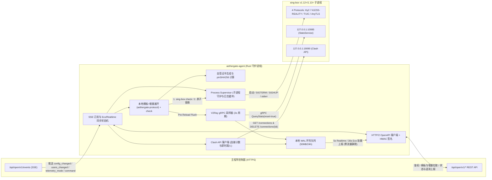
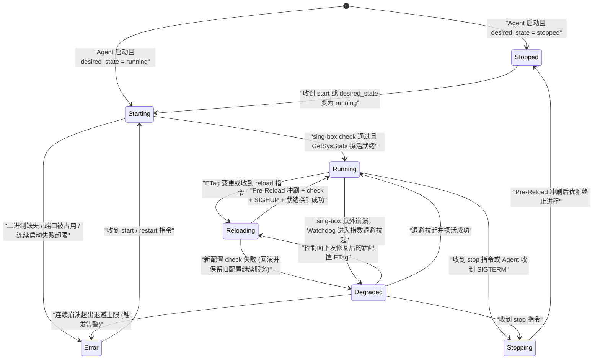

# 03 - 节点守护程序与类 Hysteria 2 开放 API 规范

> 本文档详述节点侧守护程序 `aethergate-agent` 的内部架构、生命周期状态机、Pre-Reload 零丢失流量冲刷机制、V2Ray gRPC 与 Clash API 协同采集、本地 WAL 断网补传，以及控制面暴露给节点侧的**类 Hysteria 2 开放 API（`/api/open/v1/*`）**完整协议规范。

---

## 1. 节点守护程序总体架构与状态机

### 1.1 `aethergate-agent` 内部组件拓扑

`aethergate-agent` 以单个静态编译 Rust 二进制运行在每台代理节点 VPS 上，对外仅主动发起出向 HTTPS 请求（绝不开放入站管理端口），对内通过本地环回接口与本机被守护的 `sing-box` 子进程交互。



### 1.2 节点运行态生命周期状态机

控制面始终持有期望状态 `desired_state`（`running` / `stopped`），而 Agent 负责驱使本地 `sing-box` 收敛并实时上报运行态 `runtime_state`：



---

## 2. `aethergate-agent` 核心子模块详细设计

### 2.1 Process Supervisor（进程守护器）与 CLI 入口

1. **标准化 CLI 与主机负载采集**：`aethergate-agent` 提供 `clap` 子命令：`run --config <path>`（启动守护主循环）、`check-config --config <path>`（校验本地 TOML、密钥字段及本地 `sing-box` 版本/标签，供容器健康检查与 CI 验收调用）、`version`；主机 CPU、内存与 Uptime 指标通过跨平台纯 Rust 库 `sysinfo 0.40`（`features = ["system"]`）采集，不依赖外部 shell 或 `/proc` 硬编码解析。
2. **启动前环境自检**：启动 `sing-box` 前调用 `sing-box version` 校验以下两项并在 `/report/status` 上报版本：
   - 版本满足 `>= 1.12.0`（确保 `AnyTLS` 与新版 DNS/Route 语法可用）；
   - 编译标签包含 `with_v2ray_api`（若缺失则在 `last_error` 明确报错并拒绝以盲跑模式启动）。
3. **生命周期与优雅停机**：
   - `start`：拉起 `sing-box run -c /var/lib/aethergate/configs/active.json`；使用异步管道接管 `stdout`/`stderr`，写入内存环形日志缓冲（保留最新 **500 行**，供管理员排查问题）。
   - `stop`：先触发 Pre-Reload 流量冲刷，再向子进程发送 `SIGTERM`，等待最多 **10 秒**；超时未退出则发送 `SIGKILL` 兜底，确保 TCP/UDP 端口彻底释放。
4. **崩溃自动拉起**：当 `desired_state == 'running'` 且子进程非预期退出时，按 **`1s -> 2s -> 4s -> 8s -> 30s`** 指数退避重启；若连续运行超过 60 秒则重置退避计数器。

### 2.2 Config Stager & Pre-Reload Atomic Flush（零丢失重载）

由于 `sing-box` 的 `SIGHUP` 会重建核心实例并清空内存计数器，Config Stager 必须严格执行以下 **6 步原子协议**：

1. **本地编译器展开与路径注入**：Agent 本地持久化缓存节点模板 `NodeTemplate`（来自 `/config?format=compact`）与用户表（来自 `/users?since_rev=` 增量同步）；任一变更即在本地调用共享库 `aethergate-protocol::compiler` 展开为完整 `sing-box` 1.12+ JSON，并覆写注入本机 `experimental.v2ray_api.listen`、`experimental.clash_api.{external_controller, secret}` 及本机 TLS 证书实际路径（若启用 `self_signed` 模式，首先确保自签证书已签发）。
2. **写入暂存与安全检查**：写入 `config.staging.json`（权限 `0600`），调用 `sing-box check -c config.staging.json` 进行完整 Schema 与端口语法校验。
   - 若校验失败：立即中止切换，**保留现有 `active.json` 与正在运行的 `sing-box` 服务不受任何影响**，将状态置为 `degraded` 并上报 `last_error`。
3. **加采集互斥锁并执行 Pre-Reload 原子冲刷**：获取内部 `StatsLock`，立即向即将退出的旧实例调用 `v2ray_api.QueryStats(patterns=["user>>>", "inbound>>>"], reset=true)`，将最后的尾差增量连同精确的单调时间戳压入本地 WAL 队列。
4. **原子替换**：执行 POSIX `rename(config.staging.json, active.json)`（同文件系统原子操作）。
5. **信号重载或冷启动**：若 `sing-box` 正在运行则发送 `SIGHUP`（若连续重载异常则兜底执行 Stop + Start）。
6. **就绪探针与解锁**：以 100ms 间隔轮询 `v2ray_api.GetSysStats`（超时 5s），确认新实例 gRPC 已就绪后释放 `StatsLock`、刷新 `applied_config_etag` 并上报状态。

### 2.3 V2Ray gRPC 采样器 (`stats_grpc.rs`)

Agent 在 `build.rs` 中通过 **`protox`** + **`tonic-build`** 以纯 Rust 方式编译 `v2rayapi.proto`（无需在本地或 CI 容器中预装系统级 `protoc` 二进制，完美支持 `musl` 交叉编译），对接 `sing-box/experimental/v2rayapi`：

```protobuf
syntax = "proto3";
package v2ray.core.app.stats.command;

message GetStatsRequest {
  string name = 1;
  bool reset = 2;
}

message Stat {
  string name = 1;
  int64 value = 2;
}

message GetStatsResponse {
  Stat stat = 1;
}

message QueryStatsRequest {
  // sing-box v2rayapi 中 pattern=1 已标记 deprecated；多模式匹配使用 repeated patterns=3
  string pattern = 1 [deprecated = true];
  bool reset = 2;
  repeated string patterns = 3;
  bool regexp = 4;
}

message QueryStatsResponse {
  repeated Stat stat = 1;
}

message SysStatsRequest {}
message SysStatsResponse {
  uint32 NumGoroutine = 1;
  uint32 NumGC = 2;
  uint64 Alloc = 3;
  uint64 TotalAlloc = 4;
  uint64 Sys = 5;
  uint64 Mallocs = 6;
  uint64 Frees = 7;
  uint64 LiveObjects = 8;
  uint64 PauseTotalNs = 9;
  uint32 Uptime = 10;
}

service StatsService {
  rpc GetStats(GetStatsRequest) returns (GetStatsResponse);
  rpc QueryStats(QueryStatsRequest) returns (QueryStatsResponse);
  rpc GetSysStats(SysStatsRequest) returns (SysStatsResponse);
}
```

**采集与自适应省流上报细节**：
- **本地高频采样（精度不变）**：本机始终每 **2s** 使用 `tokio::time::Instant` 单调时钟间隔读取一次 `QueryStats { pattern: "", reset: true, patterns: vec!["user>>>".into(), "inbound>>>".into()], regexp: false }`。单调时钟可免疫 VPS NTP 校时导致的速率尖刺或负值。
- **计数器解析规则**：
  - 用户维度：`user>>>{proxy_username}>>>traffic>>>uplink` 与 `downlink`；
  - 协议入站维度：`inbound>>>{tag}>>>traffic>>>uplink` 与 `downlink`（精确统计 Hysteria 2 / VLESS-REALITY / TUIC / AnyTLS 各自吞吐量）。
- **自适应窗口聚合 + 零流量静默**：
  - 当控制面通过 SSE 指示 `telemetry_mode = realtime`（面板有在线实时带宽观测者）时每 **5s** 上报一次；无人查看面板时切为 `eco` 模式每 **30s** 合并上报一次；
  - **零流量静默**：若当前上报窗口内所有 `up_bytes == 0 && down_bytes == 0 && active_conns == 0`，Agent 直接跳过本次 HTTP 上报，不浪费主服务器出网响应包；
  - 窗口内记录 `up_bytes` / `down_bytes` 总字节、`avg_up_bps` (`up_bytes * 8 * 1000 / duration_ms`) 及 `peak_up_bps`（窗口内 2s 子采样的最大瞬时峰值）。

### 2.4 Clash API 连接观测与即时踢人模块 (`clash_client.rs`)

1. **活跃连接计数**：每次采样并发访问 `GET http://127.0.0.1:{clash_port}/connections`（带本地随机生成的 `Authorization: Bearer {clash_secret}`），遍历 `connections[]` 读取 `metadata.user`（即 `proxy_username`），按用户聚合 `active_conns` 随遥测一并上报。
2. **亚秒级精准踢人**：当通过 SSE `kick_users` 事件或心跳响应收到管理员禁用用户/撤权/到期触发的 `kick_users` 名单时：
   - 调用 `GET /connections` 获取全部活跃连接；
   - 过滤 `conn.metadata.user` 命中目标名单的连接 ID；
   - 使用并发 `FuturesUnordered` 调用 `DELETE http://127.0.0.1:{clash_port}/connections/{id}` 立即切断现有 TCP/QUIC 隧道（无需等待整节点 `SIGHUP`）。

### 2.5 节点本地 TLS 辅助与 WAL 断网续传

1. **本地自签证书助手**：当节点 `tls_profile.mode == "self_signed"` 且磁盘证书不存在或剩余有效期不足 30 天时，Agent 自动用 `rcgen` 生成绑定节点 `host`（支持 IP SAN / DNS SAN）的 ECDSA P-256 证书写入指定路径，并计算证书 SHA-256 指纹（格式 `AA:BB:CC:...`），在心跳中上报给主程序作为订阅 `pinSHA256`。
2. **本地 WAL 断网缓冲**：所有遥测批次（含唯一 UUIDv7 `batch_id` 与绝对 UTC `window_start`/`window_end`）先追加写入本机 SQLite/轻量二进制日志文件（容量上限默认 `50 MB` 或最多 `24 小时`，超出按 FIFO 淘汰最老未确认批次）。主程序网络恢复后按序重放并基于 `batch_id` 幂等落库。

---

## 3. 类 Hysteria 2 开放 API 规范 (`/api/open/v1/*`)

> 本套开放 API 继承 Hysteria 2 HTTP API 的简洁强契约风格，统一基于 **HTTP/2 over TLS** + JSON + `br/zstd/gzip` 压缩（原生兼容 Hy2 External HTTP Auth，同时提供完整配置兼容模式与极致省流增量模式），节点侧无论采用官方 `aethergate-agent` 还是第三方自定义脚本均可轻松集成。

### 3.1 认证、防重放与公共请求头

| Header 名称 | 必选性 | 说明 |
| :--- | :--- | :--- |
| `Authorization` | 必选 | `Bearer <node_api_token>`（明文仅创建/轮换时展示一次，服务端存储 SHA-256 摘要） |
| `X-AG-Node-ID` | 必选 | 节点 UUID，确保 Token 与节点绑定，防止跨节点越权 |
| `Accept-Encoding` | 强烈推荐 | `br, zstd, gzip`（降低配置/用户清单出网响应字节数 75%+） |
| `X-AG-Agent-Version` | 推荐 | Agent 版本号（如 `0.1.0`） |
| `X-AG-Timestamp` | 高安全模式必选 | Unix 秒级时间戳，服务端严格校验与系统时间差在 `±60s` 内 |
| `X-AG-Nonce` | 高安全模式必选 | 每次请求的随机 UUID/Hex，服务端防重放缓存 120s |
| `X-AG-Signature` | 高安全模式必选 | `sha256=<hex>`，使用节点 `hmac_secret` 对签名串 `METHOD\nPATH_WITH_QUERY\nTIMESTAMP\nNONCE\nHEX(SHA256(BODY))` 计算 HMAC-SHA256 |

---

### 3.2 开放 API 端点完整契约

#### (1) `POST /api/open/v1/auth/verify` — 守护程序启动鉴权与能力协商

Agent 启动或重置凭证时调用，校验证书、签名、时钟偏差并下发全局上报策略。

- **Request Body**：
  ```json
  {
    "agent_version": "0.1.0",
    "singbox_version": "1.12.5",
    "singbox_tags": ["with_v2ray_api", "with_clash_api", "with_quic", "with_utls"],
    "hostname": "hk-edge-01",
    "os": "linux/amd64",
    "agent_time": "2026-11-26T14:30:00Z"
  }
  ```
- **Response (`200 OK`)**：
  ```json
  {
    "authenticated": true,
    "node_id": "550e8400-e29b-41d4-a716-446655440000",
    "node_name": "HK-BGP-01",
    "server_time": "2026-11-26T14:30:00Z",
    "clock_skew_ms": 18,
    "desired_state": "running",
    "telemetry_mode": "eco",
    "eco_interval_sec": 30,
    "realtime_interval_sec": 5,
    "heartbeat_interval_sec": 60,
    "sse_endpoint": "/api/open/v1/events"
  }
  ```

---

#### (2) `POST /api/open/v1/auth/client` — 实时客户端鉴权（原生兼容 Hysteria 2 External HTTP Auth）

本接口在语义与报文结构上**原生兼容 Hysteria 2 External HTTP Auth**（同样支持固定 HTTP `200 OK` + `{ "ok": true, "id": "..." }` / `{ "ok": false }`），可用于独立 Hy2 服务直接回调，也可用于支持外挂认证插件实时查验用户有效性（`panel_status = 'active'`、`proxy_enabled = true`、具备本节点授权且未过有效期）。

- **Request Body**：
  ```json
  {
    "addr": "203.0.113.45:52731",
    "auth": "<proxy_password_or_base64_payload>",
    "tx": 12500000
  }
  ```
  *(兼容性说明：后端同时反序列化 `auth` 与 Hysteria 2 原生字段名 `payload`，以及 `tx` 与 `send`/`recv`，并优先按本节点有效用户哈希索引匹配)*
- **Response（固定 `200 OK`）**：
  - 鉴权通过：
    ```json
    {
      "ok": true,
      "id": "u_k9x3m2p8qa"
    }
    ```
  - 鉴权拒绝（用户未启用、无本节点授权、被封禁或已过有效期）：
    ```json
    {
      "ok": false
    }
    ```

---

#### (3) `GET /api/open/v1/config` — 拉取节点配置模板或完整配置（支持 ETag / 304）

支持查询参数 `?format=compact|singbox`（均启用 `If-None-Match` / `ETag` 返回 `304 Not Modified` 及 Brotli/Gzip 压缩）：
- **`format=compact`（`aethergate-agent` 默认省流模式）**：仅返回 ~1 KB 不含用户列表的节点骨架 `NodeTemplate`（含四协议入站结构、`tls_profile` 与 `dns_route`），几乎永不变更，长期 `304`，由 Agent 在本地结合 `/users` 展开完整 `sing-box` JSON；
- **`format=singbox`（开放 API 通用兼容模式）**：直接返回已展开全部已授权用户的完整可运行 `sing-box` 1.12+ JSON，便于第三方轻量守护脚本直接写入磁盘加载。

- **Request Headers**：`If-None-Match: "sha256:9f82b1..."`（可选）
- **Response (`304 Not Modified`)**：配置无变化，0 字节响应体。
- **Response (`200 OK`, `?format=compact` 示例)**：
  ```json
  {
    "node_id": "550e8400-e29b-41d4-a716-446655440000",
    "desired_state": "running",
    "config_revision": 42,
    "etag": "sha256:9f82b1c4d5e6...",
    "generated_at": "2026-11-26T14:30:05Z",
    "tls_profile": {
      "mode": "self_signed",
      "server_name": "node-hk1.example.com",
      "cert_path": "/etc/aethergate/certs/fullchain.pem",
      "key_path": "/etc/aethergate/certs/privkey.pem"
    },
    "node_template": {
      "inbounds": [
        { "protocol": "vless_reality", "tag": "vless-reality-in", "listen": "::", "listen_port": 443, "...": "..." },
        { "protocol": "hysteria2", "tag": "hysteria2-in", "listen": "::", "listen_port": 443, "...": "..." },
        { "protocol": "tuic", "tag": "tuic-in", "listen": "::", "listen_port": 9443, "...": "..." },
        { "protocol": "anytls", "tag": "anytls-in", "listen": "::", "listen_port": 8443, "...": "..." }
      ],
      "dns_route": {}
    }
  }
  ```

---

#### (4) `GET /api/open/v1/users` — 拉取本节点已授权用户（支持全量与 `?since_rev=` 增量）

返回去重后的单份用户凭证表（避免 4 协议 + `v2ray_api` 5 倍冗余），支持 `?since_rev={rev}` 查询 `node_user_deltas` 仅拉取变更差异（约 200 字节），支持 `If-None-Match` / `ETag` -> `304`。

- **Request Headers**：`If-None-Match: "sha256:users-77a1..."`
- **Response (`200 OK` — `mode: "delta"` 增量示例)**：
  ```json
  {
    "mode": "delta",
    "from_revision": 17,
    "users_revision": 18,
    "etag": "sha256:users-77a1...",
    "added": [
      {
        "user_id": "11111111-1111-4111-8111-111111111111",
        "proxy_username": "u_k9x3m2p8qa",
        "proxy_uuid": "8c8f2f5b-1d3a-4b78-9d21-101010101001",
        "proxy_password": "<DECRYPTED_USER1_UNIQUE_PWD>"
      }
    ],
    "removed_usernames": ["u_revoked_09"]
  }
  ```
  *(当 `since_rev` 未传入或超出服务端 `node_user_deltas` 保留窗口时，自动回落返回 `"mode": "full", "users": [...]` 全量去重列表)*

---

#### (5) `POST /api/open/v1/report/status` — 节点运行态心跳上报

当 SSE 活跃时放宽至每 **60s** 上报一次（若 SSE 断线自动降级为每 **10s** 上报一次兜底）。

- **Request Body**：
  ```json
  {
    "runtime_state": "running",
    "agent_version": "0.1.0",
    "singbox_version": "1.12.5",
    "applied_config_etag": "sha256:9f82b1c4d5e6...",
    "applied_users_etag": "sha256:users-77a1...",
    "tls_cert_sha256": "AA:BB:CC:DD:EE:FF:00:11:22:33:44:55:66:77:88:99:AA:BB:CC:DD:EE:FF:00:11:22:33:44:55:66:77:88:99",
    "cpu_usage_pct": 12.4,
    "mem_used_bytes": 164208640,
    "mem_total_bytes": 2147483648,
    "uptime_sec": 84210,
    "active_connections": 37,
    "last_error": null
  }
  ```
- **Response**：
  - **常态（版本一致且无待执行指令）**：返回 **`204 No Content`**（**0 字节出网响应体**）；
  - **存在配置漂移或待执行指令 (`200 OK`)**：
    ```json
    {
      "server_time": "2026-11-26T14:31:00Z",
      "desired_state": "running",
      "telemetry_mode": "eco",
      "latest_config_etag": "sha256:9f82b1c4d5e6...",
      "latest_users_etag": "sha256:users-77a1...",
      "pending_commands": [
        {
          "command_id": "0193691f-4e1a-7a00-8000-000000000001",
          "command_type": "kick_users",
          "payload": { "proxy_usernames": ["u_banned_01"] },
          "issued_at": "2026-11-26T14:30:58Z"
        }
      ]
    }
    ```

---

#### (6) `POST /api/open/v1/report/telemetry` — 批量上报三维流量与瞬时带宽

- **Request Body**（无流量时 Agent 静默不发；有流量时按 `5s` Realtime 或 `30s` Eco 聚合发送）：
  ```json
  {
    "batch_id": "0193691f-5c90-7b12-8a31-991000000002",
    "window_start": "2026-11-26T14:31:00Z",
    "window_end": "2026-11-26T14:31:05Z",
    "duration_ms": 5002,
    "is_backfill": false,
    "node_inbounds": [
      {
        "inbound_tag": "vless-reality-in",
        "protocol": "vless_reality",
        "up_bytes": 1245184,
        "down_bytes": 20971520,
        "avg_up_bps": 1991497,
        "avg_down_bps": 33540995
      },
      {
        "inbound_tag": "hysteria2-in",
        "protocol": "hysteria2",
        "up_bytes": 850000,
        "down_bytes": 15200000,
        "avg_up_bps": 1359456,
        "avg_down_bps": 24310275
      }
    ],
    "users": [
      {
        "proxy_username": "u_k9x3m2p8qa",
        "up_bytes": 2095184,
        "down_bytes": 36171520,
        "avg_up_bps": 3350953,
        "avg_down_bps": 57851270,
        "peak_up_bps": 5242880,
        "peak_down_bps": 94371840,
        "active_conns": 14
      }
    ]
  }
  ```
- **Response**：
  - **正常接收且无需紧急踢人**：返回 **`204 No Content`**（0 字节响应，结合 HTTP/2 极省出网流量）；
  - **若有待立即切断连接（如账号刚好到期）(`200 OK`)**：`{ "accepted": true, "deduplicated": false, "kick_users": ["u_expired_01"] }`。

---

#### (7) `GET /api/open/v1/events` — 出向 HTTPS SSE 实时指令流

Agent 与主程序维持一条 HTTP/2 SSE 长连接，主程序可在数百毫秒内触发节点动作。支持标准 `Last-Event-ID` 断点续传与 **50s 极简 3 字节保活（`: \n\n`）**。

```text
HTTP/2 200 OK
content-type: text/event-stream
cache-control: no-cache

id: 0193691f-6100-7000-8000-000000000010
event: users_changed
data: {"users_revision":19,"etag":"sha256:a12b34..."}

id: 0193691f-6150-7000-8000-000000000011
event: telemetry_mode
data: {"mode":"realtime","interval_sec":5}

id: 0193691f-6200-7000-8000-000000000012
event: command
data: {"command_id":"0193691f-6200-7000-8000-000000000013","command_type":"kick_users","payload":{"proxy_usernames":["u_m4t7w9p1zb"]}}

:
```

SSE 支持的事件类型：
- `state_changed`：`{ "desired_state": "stopped" | "running" }`
- `config_changed`：`{ "config_revision": ..., "etag": "..." }`（触发重拉 `/config` 模板）
- `users_changed`：`{ "users_revision": ..., "etag": "..." }`（触发增量拉取 `/users?since_rev=`）
- `telemetry_mode`：`{ "mode": "realtime" | "eco", "interval_sec": 5 | 30 }`（控制面按面板实时观测者状态动态调节上报窗口）
- `command`：`start` / `stop` / `restart` / `reload` / `kick_users` / `fetch_logs`

---

#### (8) `POST /api/open/v1/commands/{command_id}/ack` — 指令执行结果回执

- **Request Body**：
  ```json
  {
    "status": "succeeded",
    "message": "kicked 4 active connections for u_m4t7w9p1zb",
    "data": {
      "logs": ["... (仅 fetch_logs 指令携带最近日志行) ..."]
    }
  }
  ```
- **Response**：**`204 No Content`**（已确认接收）。

---

## 4. 节点侧部署方式（单文件 systemd 与独立节点容器）

### 4.1 `/etc/aethergate/agent.toml` 示例

```toml
[control_plane]
base_url = "https://panel.example.com"
node_id = "550e8400-e29b-41d4-a716-446655440000"
api_token_file = "/etc/aethergate/secrets/api-token"
hmac_secret_file = "/etc/aethergate/secrets/hmac-secret"
enable_hmac = true
request_timeout_sec = 10

[singbox]
binary_path = "/usr/local/bin/sing-box"
config_dir = "/var/lib/aethergate/configs"
v2ray_api_listen = "127.0.0.1:10085"
clash_api_listen = "127.0.0.1:19090"

[telemetry]
sample_interval_sec = 2
report_interval_sec = 5
wal_dir = "/var/lib/aethergate/wal"
wal_max_size_mb = 50
```

### 4.2 方式一：单文件二进制 + 加固 `systemd` 单元 (`/etc/systemd/system/aethergate-agent.service`)

```ini
[Unit]
Description=Aethergate Node Daemon & sing-box Supervisor
After=network-online.target
Wants=network-online.target

[Service]
Type=simple
User=aethergate
Group=aethergate
ExecStart=/usr/local/bin/aethergate-agent run --config /etc/aethergate/agent.toml
Restart=always
RestartSec=3s
LimitNOFILE=1048576

# 允许非 root 用户绑定 443 等特权端口
AmbientCapabilities=CAP_NET_BIND_SERVICE
CapabilityBoundingSet=CAP_NET_BIND_SERVICE
NoNewPrivileges=true
ProtectSystem=strict
ReadWritePaths=/var/lib/aethergate /etc/aethergate/certs
PrivateTmp=true

[Install]
WantedBy=multi-user.target
```

### 4.3 方式二：节点独立容器部署 (`deploy/compose.agent.yaml`)

节点镜像 `ghcr.io/<owner>/aethergate-agent` 将静态 `aethergate-agent`、静态 `sing-box`（v1.12+ 含 `with_v2ray_api`）与内置 CA 根证书打包进极简 `FROM scratch` 容器，通过 `network_mode: host` 零 NAT 损耗运行：

```yaml
services:
  aethergate-agent:
    image: ghcr.io/<owner>/aethergate-agent:${AETHERGATE_TAG:-latest}
    container_name: aethergate-agent
    restart: unless-stopped
    network_mode: host
    user: "65532:65532"
    read_only: true
    security_opt:
      - no-new-privileges:true
    cap_drop:
      - ALL
    cap_add:
      - NET_BIND_SERVICE
    ulimits:
      nofile:
        soft: 1048576
        hard: 1048576
    tmpfs:
      - /tmp:rw,noexec,nosuid,size=16m
    volumes:
      - ./config:/etc/aethergate:ro
      - ./data:/var/lib/aethergate:rw
    environment:
      # 如需信任私有 CA 签发的控制面证书，可挂载并指定 SSL_CERT_FILE
      # SSL_CERT_FILE: /etc/aethergate/certs/ca.crt
      RUST_LOG: "info,aethergate_agent=info"
```
