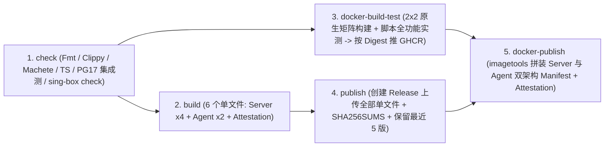

# 05 - 生产部署、代码门禁、单文件/双容器 CI/CD 与实施路线图

> 本文档完整定义 **Æthergate** 的单文件多平台发行体系、主机控制面与节点守护各自独立的极简 `FROM scratch` 多架构容器规格、对标 `Linguist-New` 工程实践的本地严格代码检查门禁与 GitHub Actions CI/CD 流水线、STRIDE 安全模型、可观测性指标及 Phase 0 ~ Phase 5 实施计划。

---

## 1. 单文件发布与主机/节点双容器架构

### 1.1 自动化 Release 交付产物矩阵

每次主分支发布自动产出以下全部**单文件可执行二进制**与**双独立多架构 Docker 镜像**，所有二进制均附带 `SHA256SUMS.txt` 及 **GitHub Build Provenance Attestation（构建来源证明）**：

| 产物类别 | 目标平台 / 镜像坐标 | 构建特征 |
| :--- | :--- | :--- |
| **控制面单文件 (`aethergate-server`)** | `aethergate-server-linux-x64` (`x86_64-unknown-linux-musl`)<br>`aethergate-server-linux-arm64` (`aarch64-unknown-linux-musl`)<br>`aethergate-server-windows-x64.exe` (`x86_64-pc-windows-msvc`)<br>`aethergate-server-windows-arm64.exe` (`aarch64-pc-windows-msvc`) | 通过 `rust-embed` 内嵌 `frontend/dist` 与 SQLx `migrations/`；Linux x64/arm64 全静态链接（`+crt-static`）；Windows 启用 `/OPT:REF,ICF` |
| **节点守护单文件 (`aethergate-agent`)** | `aethergate-agent-linux-x64` (`x86_64-unknown-linux-musl`)<br>`aethergate-agent-linux-arm64` (`aarch64-unknown-linux-musl`) | 纯静态零动态库依赖（无 `libc` / `OpenSSL` / `protoc` 外部依赖），直接拷贝到任意 Linux VPS 配合官方 `sing-box` 运行 |
| **主机控制面 Docker 镜像** | `ghcr.io/<owner>/aethergate-server:{tag,latest}` | `linux/amd64` + `linux/arm64` 原生双架构；`FROM scratch` 非 root (`65532:65532`)、只读根文件系统、内置前后端与迁移 |
| **节点守护 Docker 镜像** | `ghcr.io/<owner>/aethergate-agent:{tag,latest}` | `linux/amd64` + `linux/arm64` 原生双架构；`FROM scratch` 非 root (`65532:65532`)，内含静态 `aethergate-agent` + 官方静态 `sing-box`（含 `with_v2ray_api`）+ CA 根证书 |

---

### 1.2 主机控制面容器 (`deploy/Dockerfile.server` & `deploy/compose.server.yaml`)

#### `deploy/Dockerfile.server`（三阶段极简 `scratch` 构建）

```dockerfile
# syntax=docker/dockerfile:1

FROM --platform=$BUILDPLATFORM node:24-bookworm-slim AS frontend-builder
WORKDIR /app/frontend
COPY frontend/package.json frontend/package-lock.json ./
RUN npm ci
COPY frontend/ ./
RUN npm run build

FROM rust:1-bookworm AS rust-builder
ARG TARGETARCH
WORKDIR /app

RUN apt-get update \
    && apt-get install -y --no-install-recommends musl-tools binutils \
    && rm -rf /var/lib/apt/lists/*

RUN ARCH="${TARGETARCH:-$(dpkg --print-architecture)}" \
    && case "${ARCH}" in \
      amd64) echo "x86_64-unknown-linux-musl" > /tmp/rust-target ;; \
      arm64) echo "aarch64-unknown-linux-musl" > /tmp/rust-target ;; \
      *) echo "Unsupported TARGETARCH: ${ARCH}" >&2; exit 1 ;; \
    esac \
    && rustup target add "$(cat /tmp/rust-target)"

COPY Cargo.toml Cargo.lock sqlx.toml ./
COPY crates ./crates
COPY --from=frontend-builder /app/frontend/dist ./frontend/dist

RUN TARGET="$(cat /tmp/rust-target)" \
    && export CC_x86_64_unknown_linux_musl=musl-gcc \
    && export CC_aarch64_unknown_linux_musl=musl-gcc \
    && export RUSTFLAGS="-C target-feature=+crt-static" \
    && cargo build --release --locked --bin aethergate-server --target "${TARGET}" \
    && install -Dm755 "target/${TARGET}/release/aethergate-server" /out/aethergate-server \
    && (! readelf -l /out/aethergate-server | grep -q 'INTERP') \
    && install -d -m 0755 -o 65532 -g 65532 /out/config

FROM scratch
LABEL org.opencontainers.image.title="Aethergate Server" \
      org.opencontainers.image.description="sing-box multi-node control plane and telemetry dashboard" \
      org.opencontainers.image.licenses="AGPL-3.0"

COPY --from=rust-builder /out/aethergate-server /aethergate-server
COPY --from=rust-builder --chown=65532:65532 /out/config /config

WORKDIR /config
USER 65532:65532
EXPOSE 8080

ENTRYPOINT ["/aethergate-server"]
CMD ["serve", "--config", "/config/config.toml"]
```

*(注：若在 `amd64` 宿主机交叉构建 `arm64` 时启用 `aarch64-linux-musl-gcc` 即可；但在 GitHub CI 中直接使用 `ubuntu-24.04-arm` 原生编译 `arm64`，保证零 QEMU 仿真开销与极致构建速度)*

#### `deploy/compose.server.yaml`（生产安全加固编排）

```yaml
services:
  timescaledb:
    image: timescale/timescaledb-ha:pg17
    container_name: aethergate-db
    restart: unless-stopped
    environment:
      POSTGRES_DB: aethergate
      POSTGRES_USER: aethergate
      POSTGRES_PASSWORD: ${DB_PASSWORD}
    volumes:
      - pg_data:/home/postgres/pgdata/data
    healthcheck:
      test: ["CMD-SHELL", "pg_isready -U aethergate"]
      interval: 5s
      timeout: 5s
      retries: 10

  aethergate-server:
    image: ghcr.io/<owner>/aethergate-server:${AETHERGATE_TAG:-latest}
    container_name: aethergate-server
    restart: unless-stopped
    stop_grace_period: 30s
    depends_on:
      timescaledb:
        condition: service_healthy
    ports:
      # 默认仅绑定回环，由主机 Caddy / Nginx 终结 TLS 并代理 SSE / WS
      - "127.0.0.1:8080:8080"
    user: "65532:65532"
    read_only: true
    security_opt:
      - no-new-privileges:true
    cap_drop:
      - ALL
    tmpfs:
      - /tmp:rw,noexec,nosuid,size=16m
    volumes:
      - ./docker/server-config:/config:ro
      - /etc/timezone:/etc/timezone:ro
      - /etc/localtime:/etc/localtime:ro
      - /etc/ssl/certs:/etc/ssl/certs:ro
    environment:
      AETHERGATE_MASTER_KEY_HEX: ${MASTER_KEY_HEX}
      AETHERGATE_BOOTSTRAP_ADMIN_EMAILS: ${ADMIN_EMAILS:-}
      # SSL_CERT_FILE: /config/certs/ca.crt
    deploy:
      resources:
        limits:
          cpus: "2.0"
          memory: 512M

volumes:
  pg_data:
```

> **反向代理必配项（Caddy / Nginx）**：为 `/api/open/v1/events`（SSE）与 `/api/v1/ws/realtime`（WebSocket）禁用上游缓冲（Nginx 设置 `proxy_buffering off; proxy_read_timeout 3600s;`），避免实时指令或瞬时带宽帧滞留。

---

### 1.3 节点守护独立容器 (`deploy/Dockerfile.agent` & `deploy/compose.agent.yaml`)

#### `deploy/Dockerfile.agent`（静态 Agent + 静态 `sing-box` 双二进制极简容器）

```dockerfile
# syntax=docker/dockerfile:1

FROM golang:1.24-bookworm AS singbox-builder
ARG SINGBOX_VERSION=1.12.5
WORKDIR /src
RUN git clone --depth 1 --branch "v${SINGBOX_VERSION}" https://github.com/SagerNet/sing-box.git . \
    && CGO_ENABLED=0 go build -v -trimpath \
       -tags "with_v2ray_api,with_clash_api,with_quic,with_utls,with_reality_server,with_acme" \
       -ldflags "-s -w -buildid=" \
       -o /out/sing-box ./cmd/sing-box \
    && /out/sing-box version | grep -q "with_v2ray_api"

FROM rust:1-bookworm AS agent-builder
ARG TARGETARCH
WORKDIR /app
RUN apt-get update \
    && apt-get install -y --no-install-recommends musl-tools binutils ca-certificates \
    && rm -rf /var/lib/apt/lists/*
RUN ARCH="${TARGETARCH:-$(dpkg --print-architecture)}" \
    && case "${ARCH}" in \
      amd64) echo "x86_64-unknown-linux-musl" > /tmp/rust-target ;; \
      arm64) echo "aarch64-unknown-linux-musl" > /tmp/rust-target ;; \
      *) echo "Unsupported TARGETARCH: ${ARCH}" >&2; exit 1 ;; \
    esac \
    && rustup target add "$(cat /tmp/rust-target)"

COPY Cargo.toml Cargo.lock ./
COPY crates ./crates

RUN TARGET="$(cat /tmp/rust-target)" \
    && export RUSTFLAGS="-C target-feature=+crt-static" \
    && cargo build --release --locked --bin aethergate-agent --target "${TARGET}" \
    && install -Dm755 "target/${TARGET}/release/aethergate-agent" /out/aethergate-agent \
    && (! readelf -l /out/aethergate-agent | grep -q 'INTERP') \
    && install -d -m 0755 -o 65532 -g 65532 /out/etc-aethergate /out/var-aethergate

FROM scratch
LABEL org.opencontainers.image.title="Aethergate Node Agent" \
      org.opencontainers.image.description="sing-box node supervisor with V2Ray gRPC telemetry and Open API sync"

COPY --from=agent-builder /etc/ssl/certs/ca-certificates.crt /etc/ssl/certs/ca-certificates.crt
COPY --from=singbox-builder /out/sing-box /usr/local/bin/sing-box
COPY --from=agent-builder /out/aethergate-agent /usr/local/bin/aethergate-agent
COPY --from=agent-builder --chown=65532:65532 /out/etc-aethergate /etc/aethergate
COPY --from=agent-builder --chown=65532:65532 /out/var-aethergate /var/lib/aethergate

WORKDIR /var/lib/aethergate
USER 65532:65532
ENTRYPOINT ["/usr/local/bin/aethergate-agent"]
CMD ["run", "--config", "/etc/aethergate/agent.toml"]
```

*(节点容器对应的 `deploy/compose.agent.yaml` 完整配置见 [03 号文档 §4.3](./03-node-daemon-and-open-api.md#43-方式二节点独立容器部署-deploycomposeagentyaml))*

---

### 1.4 高可用多实例与节点防火墙四协议端口矩阵

1. **控制面横向扩展**：多副本部署时引入 **Redis 7 / Valkey**（通过 `redis 1.8` `tokio-rustls-comp` 接入），用于跨副本同步实时带宽热快照与 Pub/Sub 广播 `bandwidth_tick` / SSE 节点控制指令；后端连接高可用主从 PostgreSQL + TimescaleDB 集群。
2. **四协议单节点标准防火墙开放矩阵**：

| 协议入站 | 传输协议 | 推荐开放端口 | 说明 |
| :--- | :--- | :--- | :--- |
| `vless_reality` | **TCP** | `443` | 与 Hysteria 2 UDP 443 共存无冲突 |
| `anytls` | **TCP** | `8443` | 可按需调整为 `2053` / `8443` |
| `hysteria2` | **UDP** | `443`（可选跳跃区间 `20000:30000`） | 启用端口跳跃时在宿主配置 `nftables`/`iptables` PREROUTING 重定向至监听端口 |
| `tuic` | **UDP** | `9443` | 建议调大 `net.core.rmem_max` 与 `wmem_max` 至 `8MB+` |
| **管理通信** | **零入站端口** | **无需放行** | Agent 仅出向连控制面 `443`；本机 `10085`/`19090` 严格监听 `127.0.0.1` |

### 1.5 阿里云按量计费 ECS 成本优化与带宽兜底清单

面向**仅对公网出方向流量计费（约 ¥0.8/GB）、公网入方向与同地域 VPC 内网均免费**的阿里云按量计费 ECS，本系统通过架构级减负将控制面公网出网压至极低水平：

| 流量来源 | 省流优化策略 | 预期节流效果 |
| :--- | :--- | :--- |
| **节点配置同步** | 共享 `aethergate-protocol::compiler` 下沉节点本地展开；`GET /config` 仅传 ~1 KB 无用户骨架（常年 `304`）；`GET /users?since_rev=` 增量 Diff + Brotli 压缩 | **出网降约 99%**（变更 1 人 ~175 KB -> ~200 B） |
| **节点遥测与心跳回包** | 全程 **HTTP/2 over TLS**（HPACK 头部压缩）；无指令/踢人一律返回 **0 字节 `204 No Content`**；零流量静默；无人浏览面板时 SSE 切换 **Eco 模式 (30s)** | **出网降约 85%~90%** |
| **持久面板 WebSocket** | **保留持久连接不断开** + `permessage-deflate`；事件驱动脏推送（无变化不重发、0 值不刷屏）；视口订阅 + 切后台 30s 暂停带宽频道保留状态频道 | **出网降约 90%+** |
| **静态页面与订阅接口** | 前端预编译 `.br` (level 11) + 系统字体栈；**SPA 白名单路由防扫描**（未知探测路径返回 0 字节 `404`）；`/sub/{token}` 强 `ETag`/`304` + `Profile-Update-Interval: 24` + 限流 | 严防扫描器刷出 `index.html` 费用暴涨 |
| **镜像、安装包与数据库** | 安装包/双 Docker 镜像托管于 GitHub/GHCR（一键安装脚本仅输出 ~1 KB 文本引导直连下载）；PG/TimescaleDB 走同机或同区 VPC 内网 | **主服务器分发出网 = 0** |

- **阿里云控制台硬兜底建议**：在 ECS 控制台将按流量计费实例的**公网出方向带宽峰值上限设为 `5~10 Mbps`**（足够面板与数十台节点控制信令丝滑通信，即使极端 CC 攻击也可锁死最大计费天花板），并开启按小时出网费用预警。
- **月出网用量与成本参考（¥0.8/GB）**：小型（5 节点 / 20 用户）约 **80 ~ 200 MB/月（< ¥0.2）**；中型（20 节点 / 100 用户）约 **300 ~ 700 MB/月（¥0.3 ~ ¥0.6）**；较大集群（50 节点 / 500 用户）约 **1.0 ~ 2.0 GB/月（¥0.8 ~ ¥1.6）**。

---

## 2. 本地代码门禁与自动化 CI/CD 流水线（对标 `Linguist-New`）

### 2.1 本地强门禁（`justfile` + `scripts/check.ps1`）

提交代码与 CI 运行共享完全一致的 5 级强制质量门禁（任何告警均视为失败）：

| 门禁阶段 | Just Target | 执行命令 | 拦截内容 |
| :--- | :--- | :--- | :--- |
| **1. 格式校验** | `just check-format` | `cargo fmt --all -- --check` | Rust 代码风格不一致 |
| **2. 类型校验** | `just check-types` | `cd frontend && npm run typecheck` (`tsc --noEmit`)<br>`cargo check --workspace --all-targets --all-features` | TypeScript 严格类型错误、Rust 编译/SQLx 类型错误 |
| **3. 静态检查** | `just check-lint` | `cd frontend && npm run lint` (`eslint .` strictTypeChecked)<br>`cargo clippy --workspace --all-targets --all-features -- -D warnings` | `any` 类型、浮空 Promise、`unwrap/expect/panic`、缺失文档注释、`pedantic` 隐患 |
| **4. 冗余依赖** | `just check-deps` | `cargo machete` | Cargo.toml 中未实际使用的僵尸依赖 |
| **5. 构建与测试** | `just check-test` | `cd frontend && npm run build`<br>`cargo test --workspace --locked` | 前端内嵌产物生成失败、单测及合约测试失败 |

Windows 本地研发一键执行 `pwsh -File scripts/check.ps1` 串联上述全部步骤。

### 2.2 自动化 CI/Release 流水线 (`.github/workflows/ci-release.yml`)



1. **`check` Job**：启动 `postgres:17`（或 TimescaleDB）服务，安装 Node 24、`cargo-machete` 与测试用 `sing-box` v1.12+；依次跑通前端 `npm ci && typecheck && lint && build`、后端 `fmt && clippy && machete && test --locked` 及配置编译输出经真实 `sing-box check` 检验的集成测试。
2. **`build` Job（单文件矩阵）**：
   - 构建 4 个控制面单文件：`aethergate-server-windows-x64.exe`、`aethergate-server-windows-arm64.exe`（自动配置 MSVC 环境变量 + `/OPT:REF,ICF`）、`aethergate-server-linux-x64`（`musl-tools`）、`aethergate-server-linux-arm64`（`aarch64-unknown-linux-musl`）；先执行 `npm run build` 使 `rust-embed` 内嵌最新前端；
   - 构建 2 个节点守护单文件：`aethergate-agent-linux-x64` 与 `aethergate-agent-linux-arm64`（全静态 `musl`）；
   - 每个二进制产物均通过 `actions/attest-build-provenance@v4` 生成来源证明。
3. **`docker-build-test` Job（双镜像 × 双架构原生先测后推）**：
   - 矩阵覆盖 `server (amd64 / arm64)` 与 `agent (amd64 / arm64)`，其中 `arm64` 使用原生 `ubuntu-24.04-arm` Runner；
   - **主机容器验证脚本 (`scripts/test-docker-server.sh`)**：
     1. `docker save` 解析 Tar 层，**强断言纯 `scratch` 内仅含 `/aethergate-server` 与 `/config` 目录**且 `User = 65532:65532`；
     2. 启动临时 TLS PostgreSQL 与 Mock OIDC Server，验证 `check-config`；
     3. Phase A 测试无 `SSL_CERT_FILE` 下的公网 `webpki` HTTPS + PG `sslrootcert`；Phase B 测试 `SSL_CERT_FILE` 私有 CA；验证内嵌首页 `200 <html`、未授权 `/api/v1/admin/nodes` 返回 `401`、重启持久化与空闲内存采集；
   - **节点容器验证脚本 (`scripts/test-docker-agent.sh`)**：
     1. 解析 Tar 层校验 `/usr/local/bin/aethergate-agent`、`/usr/local/bin/sing-box`、`ca-certificates.crt` 与非 root `65532:65532`；
     2. 验证容器内 `/usr/local/bin/sing-box version` 输出包含 `with_v2ray_api` 且版本 `>= 1.12.0`；
     3. 联合 Mock Control Plane（Python HTTPS Server，验证 HMAC 签名）完成：`/auth/verify` -> `/config`（拉取四协议测试配置）-> `sing-box check` -> 拉起 `sing-box` 子进程 -> gRPC `GetSysStats`/`QueryStats` -> `/report/status`（`runtime_state=running`）与 `/report/telemetry` -> 下发 `stop` 指令验证优雅退出。
   - **只有容器实测全部通过**，才以 `push-by-digest=true` 推送各架构候选层至 GHCR 并导出 digest 文件。
4. **`publish` & `docker-publish` Jobs**：
   - 生成标签 `v${CARGO_VERSION}-b${RUN_NUMBER}-${SHORT_SHA}`，聚合全部 6 个单文件与 `SHA256SUMS.txt` 发布 GitHub Release（自动清理旧构建仅保留最近 5 个）；
   - 分别使用 `docker buildx imagetools create` 将已通过测试的 `amd64` + `arm64` digest 合成多架构镜像 `ghcr.io/<owner>/aethergate-server:{tag,latest}` 与 `ghcr.io/<owner>/aethergate-agent:{tag,latest}`，并推送容器级 Provenance Attestation。

### 2.3 自动化部署与健康探针回滚 (`.github/workflows/deploy.yml`)

1. **主机控制面自动部署**：监听 `CI & Release Pipeline` 成功完成或手动 `workflow_dispatch`（可控开关 `vars.ENABLE_AUTO_DEPLOY == 'true'`）：
   - 同步参考 `compose.server.yaml` 与 `config.server.example.toml` 至远程服务器 `${DEPLOY_DIR}/examples/`（**绝不覆盖生产实际 `.env` 与 `docker/server-config/`**）；
   - 记录当前运行的 `PREV_TAG`，写入目标 `AETHERGATE_TAG`，执行 `docker compose pull aethergate-server && docker compose up -d --remove-orphans aethergate-server`；
   - 循环 15×2s 探测 `/healthz`；若探针失败立即自动回滚至 `PREV_TAG` 并打印容器最近 60 行日志报错退出。
2. **节点容器升级策略**：出于全球多节点连接稳定性考虑（重启容器会短暂断开用户活跃代理连接），节点镜像不随每次提交强制全网自动滚动，而由运维通过节点编排/批量 SSH 执行 `AETHERGATE_TAG=<tag> docker compose pull && docker compose up -d` 在低峰期分批升级。

---

## 3. 安全威胁建模 (STRIDE) 与纵深防御

| 威胁类别 | 潜在攻击面与风险场景 | 纵深防御措施 |
| :--- | :--- | :--- |
| **Spoofing (身份伪造)** | 伪造 OIDC 回调、伪造节点 Agent 上报假流量或窃取节点配置 | 1) OIDC 强制校验 PKCE S256 + `state` + `nonce` + JWKS 签名及 `iss`/`aud`；<br>2) 节点开放 API 强制 HTTPS + `Bearer Token`（DB 存 SHA-256）+ `X-AG-Node-ID` 绑定 + 推荐启用 HMAC-SHA256 防重放签名（`±60s` + `Nonce` 去重） |
| **Tampering (数据篡改)** | CSRF 修改配置；劫持本机环回或容器逃逸篡改统计 | 1) Session Cookie 设 `HttpOnly; Secure; SameSite=Lax`，写操作强验 `X-CSRF-Token`；<br>2) `v2ray_api` 与 `clash_api` 严格监听 `127.0.0.1`，每次随机注入高熵 `secret`；<br>3) 双镜像均基于无 shell 的 `FROM scratch`、`read_only: true`、`cap_drop: [ALL]`、`USER 65532:65532` 运行 |
| **Repudiation (抵赖)** | 管理员误操作启停节点、放行高危用户或重置凭证无法追责 | 所有关键写操作统一写入不可变 `audit_logs`（操作者 ID、来源 IP、前后 `diff_json`、精确时间戳） |
| **Information Disclosure (信息泄露)** | 数据库泄露暴露密码/REALITY 私钥；普通用户越权查看未授权节点 | 1) `proxy_password`、`hmac_secret`、`tls.reality.private_key` 使用 AES-256-GCM 静态加密落库；<br>2) 订阅 Token 存 SHA-256 且 `/sub/{token}` 实施 IP 级速率限制；<br>3) WS 频道订阅逐条校验会话角色与节点授权；<br>4) 全局唯一 `proxy_password_hash` 彻底杜绝 Hy2/AnyTLS 多用户口令碰撞 |
| **Denial of Service (拒绝服务)** | 恶意配置致 `sing-box` 崩溃；海量补传或订阅请求压垮主库 | 1) Agent 替换前必执行 `sing-box check`，失败立即保留旧配置运行；<br>2) 遥测上报受 `batch_id` 幂等去重保护，本地 WAL 限制上限 `50MB/24h`；<br>3) 面板高频实时带宽走内存 `DashMap`，不穿透 PostgreSQL |
| **Elevation of Privilege (权限提升)** | Logto 自助注册后绕过审批直接拉取节点配置或调用管理接口 | 1) JIT 建档硬编码 `role='user', proxy_enabled=false`；<br>2) `/api/v1/admin/*` 挂载 `RequireAdmin` 提取器；<br>3) 订阅导出、配置编译器、`auth/client` 实时鉴权三处同时强校验 `panel_status='active' AND proxy_enabled=true` 且具备有效节点授权 |

---

## 4. 可观测性与运维告警

### 4.1 结构化日志与健康探针

- **日志规范**：主程序与 Agent 均使用 `tracing` + `tracing-subscriber` 输出结构化 JSON 日志，绑定 `request_id`、`node_id`、`user_id`、`batch_id`，严禁输出明文凭证或 Cookie。
- **控制面探针**：`GET /healthz`（进程存活）、`GET /readyz`（PostgreSQL + JWKS 就绪校验）。
- **Prometheus 指标 (`/metrics`)**：`aethergate_nodes_online_total`、`aethergate_nodes_by_state`、`aethergate_live_bandwidth_bps`、`aethergate_telemetry_batches_total`、`aethergate_telemetry_ingest_duration_seconds`、`aethergate_config_compile_errors_total`、`aethergate_ws_active_connections`、`aethergate_node_sse_active_connections`。

### 4.2 核心生产告警规则建议

| 告警名称 | 触发条件 | 建议处置措施 |
| :--- | :--- | :--- |
| `NodeAgentOffline` | `desired_state = 'running'` 但 `agent_online = false` 持续 `> 60s` | 检查节点网络、`aethergate-agent` 容器/systemd 日志及控制面 TLS 证书 |
| `SingBoxConfigDegraded` | `runtime_state IN ('degraded', 'error')` 持续 `> 30s` | 查看节点详情页 `last_error` 与最新 500 行 `stderr` 日志 |
| `TelemetryIngestSlow` | `aethergate_telemetry_ingest_duration_seconds` P99 `> 500ms` | 检查 TimescaleDB 磁盘 IO、Continuous Aggregate 任务积压及连接池配置 |
| `NodeClockSkewHigh` | `/auth/verify` 或 HMAC 验签持续返回时间戳偏差过大 | 检查节点宿主 `chrony` / `systemd-timesyncd` NTP 时间同步 |

---

## 5. 分阶段实施路线图与验证矩阵

### 5.1 实施里程碑 (Phase 0 ~ Phase 5)

| 阶段 | 周期建议 | 核心交付物与里程碑验收标准 |
| :--- | :--- | :--- |
| **Phase 0：工程基座、严苛门禁与开发容器** | Week 1 | 初始化 Cargo Workspace（含严苛 `workspace.lints` 与 `profile.release`）、`sqlx.toml`、`frontend/`（`npm` + `shadcn-admin` + Tailwind v4 + `eslint.config.js` strictTypeChecked + `tsconfig.json`）；落地 `justfile`、`scripts/check.ps1` 与基础 `.github/workflows/ci-release.yml` 门禁 |
| **Phase 1：认证、数据库与 RBAC** | Week 2 | 完成 PostgreSQL + TimescaleDB 全部迁移脚本；落地 OIDC/Logto BFF 登录、JIT 默认拒绝建档（`proxy_enabled=false`）、Session/CSRF、用户审批与节点分组授权 CRUD API |
| **Phase 2：开放 API 与四协议节点守护** | Week 3-4 | 完成共享库 `aethergate-protocol::compiler`（`VLESS-REALITY` / `Hysteria 2` / `TUIC` / `AnyTLS` + 共享 TLS + 端口冲突校验）；落地 `/api/open/v1/*`（HTTP/2 + `204 No Content` + `/config` 骨架 + `/users?since_rev=` 增量）与 `aethergate-agent`（`protox` gRPC、本地展开、`sing-box check` 预检、SSE `50s` 保活与裸机/容器部署） |
| **Phase 3：三维采集、踢人与实时流** | Week 5 | 实现 `v2rayapi.proto` gRPC 2s 采样、Eco(30s)/Realtime(5s) 自适应上报、零流量静默、Pre-Reload 冲刷、WAL 补传与 Clash 踢人；落地 `DashMap` 热路径、持久 WS `/api/v1/ws/realtime`（`permessage-deflate` + 脏推送）与 TimescaleDB 多级聚合查询 |
| **Phase 4：管理面板与用户门户前端** | Week 6-7 | 完成管理员驾驶舱、节点四协议构建器、用户审批与授权穿梭框、三维统计中心（用户×节点交叉矩阵与协议占比）、普通用户待审批页与订阅页（`304` + 限流），并实现 **Brotli 预压缩内嵌 + SPA 路由白名单 0 字节 404 防扫描**与切后台 WS 频道优雅降载 |
| **Phase 5：双容器发布、自动部署与压测加固** | Week 8 | 完成 `Dockerfile.server`、`Dockerfile.agent`、`test-docker-server.sh`、`test-docker-agent.sh`、完整 `ci-release.yml`（6 单文件 + 2 双架构镜像 + Provenance Attestation）与 `deploy.yml` 自动回滚流水线；完成 100 节点×1000 用户压测 |

### 5.2 全链路测试验证矩阵

| 测试层级 | 工具与方法 | 关键验证断言 |
| :--- | :--- | :--- |
| **静态与依赖门禁** | `just check` / `scripts/check.ps1` | `cargo fmt`、`clippy -D warnings`（零 `unwrap/expect/panic`）、`cargo machete`、`tsc --noEmit`、`eslint strictTypeChecked` 全量零警告通过 |
| **Rust 单元测试** | `cargo test --workspace --locked` | 四协议 TCP/UDP 端口冲突与 Hy2 区间重叠检测；HMAC-SHA256 签名与 `±60s` 防重放窗；`proxy_password` 唯一性；ETag 稳定性；单位换算（`bps` vs `Bytes`） |
| **配置与真实内核校验** | 集成测试调用真实 `sing-box check` 二进制 | 共享编译器本地展开包含全部 4 个协议 + 新版 `dns.servers` + `route.rules` + `v2ray_api` + `clash_api` 的 JSON 通过 `sing-box v1.12+ check` 零错误；验证模板+增量展开与全量编译字节级一致 |
| **数据库与时序聚合测试** | `sqlx::test` + `Testcontainers` / CI PG Service | 重复 `batch_id` 幂等去重；并发上报无死锁；有效授权排除 `proxy_enabled=false` / 未授权 / 过期用户；`node_user_deltas` 增量查询与全量对齐；跨自然月边界（`11-30 23:59:58` vs `12-01 00:00:03` 按配置时区）与跨月 WAL 补传精准归属原 `stat_month` 且新月 1 号查询自然从 `0` 起算；Continuous Aggregates 与明细之和一致 |
| **双容器端到端验收** | `scripts/test-docker-server.sh` & `test-docker-agent.sh` | 纯 `scratch` 布局与 `65532:65532` 权限；Server 内嵌 `.br` 资产、SPA 未知路径空体 404、`204 No Content`、TLS/PG/401 全链路校验；Agent 内含 `sing-box` 标签校验 + Mock 控制面验证增量同步与 Eco/Realtime 切换 |
| **前端与 E2E 测试** | `Vitest` + `Playwright` | OIDC 自助注册用户仅可进入待审批页；管理员审批授权后四协议生效、持久 WS 脏推送实时刷新带宽曲线、切后台仅暂停带宽频道且恢复不断连、关闭开关亚秒级踢断连接 |
